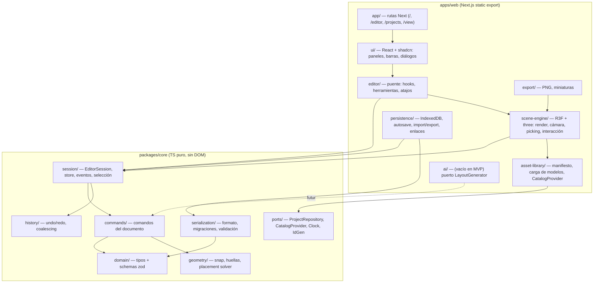
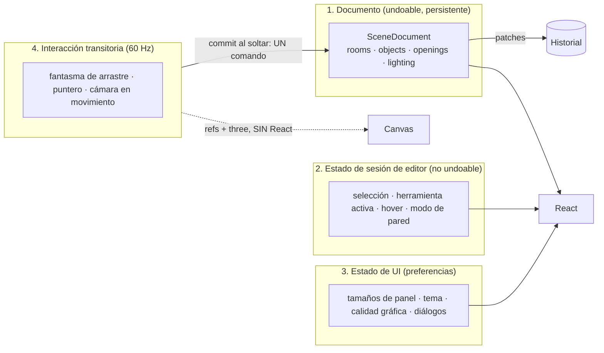
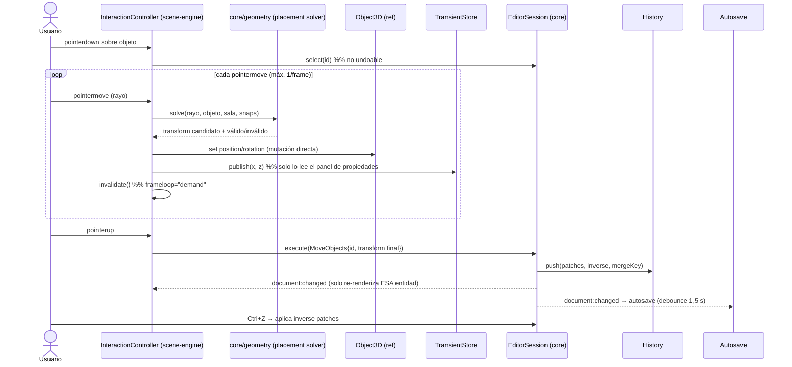
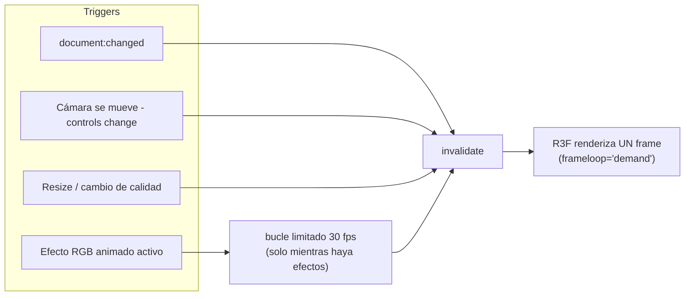
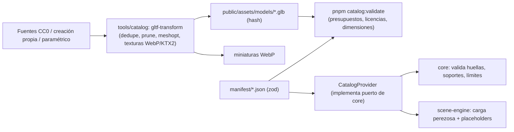
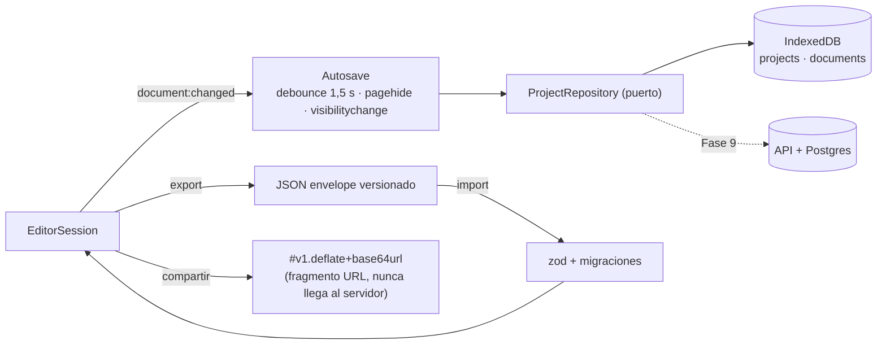
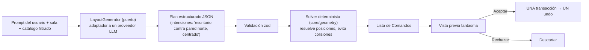

# RoomForge — Arquitectura

> Estado: **borrador para aprobación** (Fase 0) · 2026-10-08
> Decisiones individuales: [ADR/](ADR/) · Modelo de datos: [DOMAIN_MODEL.md](DOMAIN_MODEL.md) · Investigación de rendimiento: [research/R3F_PERFORMANCE.md](research/R3F_PERFORMANCE.md)

## 0. Resumen ejecutivo

- **Un monorepo pnpm mínimo** con dos piezas: `packages/core` (TypeScript puro: dominio, comandos, historial, serialización — **sin React, sin three, sin DOM**) y `apps/web` (Next.js 16 con *static export*, UI, motor de escena R3F, persistencia IndexedDB).
- **Todo cambio del documento pasa por un Comando.** Los comandos producen *patches* de Immer → undo/redo gratis, serializable, testeable, reutilizable por la IA y por una futura colaboración.
- **El estado se divide en capas** (documento / sesión de editor / UI / interacción transitoria). Lo que cambia 60 veces por segundo **nunca** pasa por React ni por el historial.
- **Render bajo demanda** (`frameloop="demand"`), suscripciones granulares por entidad, recursos compartidos con conteo de referencias y un **pool fijo de luces** con presupuesto por calidad.
- **Local-first sin backend** en el MVP: IndexedDB + exportación JSON + enlaces con la escena comprimida en el fragmento de la URL. Postgres/cuentas quedan detrás de una interfaz (`ProjectRepository`) para la Fase 9.
- **Hosting**: Cloudflare (estático). Se evita Vercel Hobby porque su plan gratuito es solo para uso no comercial (incompatible con la monetización prevista).
- **Sin sobreingeniería**: nada de microservicios, ni ECS, ni CRDT, ni WebGPU, ni React Compiler en el MVP. Cada uno tiene su punto de revisión documentado.

## 1. Cambios propuestos respecto al stack inicial (justificados)

| Propuesta del brief | Decisión | Justificación | ADR |
|---|---|---|---|
| Next.js | **Mantener**, con `output: 'export'` (SPA estática) en el MVP | Landing/SEO/OG y backend futuro en la misma base. El motor no depende de Next: si estorba, el editor migra a Vite sin tocar `core` ni `scene-engine`. | [0002](ADR/0002-nextjs-static-export.md) |
| Repo único | **Monorepo pnpm con 2 paquetes** (`core`, `web`) | La pureza del motor se garantiza por *construcción* (el paquete no declara `react`/`three`/DOM), no por disciplina. Permite testear en Node en milisegundos y reutilizar `core` en el servidor (validación, IA). | [0001](ADR/0001-monorepo-core-package.md) |
| Zustand como estado | **Mantener** (`zustand/vanilla` en core, hooks en web) + Immer para el documento | Zustand ya es dependencia interna de R3F; vanilla permite que `core` no dependa de React. | [0003](ADR/0003-state-and-commands.md) |
| IndexedDB | **Mantener** vía `idb` (envoltorio de ~1 KB) tras `ProjectRepository` | Dexie es más potente de lo necesario; no hay consultas complejas. | [0004](ADR/0004-persistence-indexeddb.md) |
| «Hosting gratuito compatible con Next.js» | **Cloudflare** (Workers static assets / Pages) | Vercel Hobby = solo no comercial. Ver [DEPLOYMENT](DEPLOYMENT.md). | [0005](ADR/0005-hosting-cloudflare.md) |
| ESLint/Prettier (implícito) | **Biome 2** + dependency-cruiser | Una sola herramienta rápida; las fronteras arquitectónicas se verifican con dependency-cruiser. | [0008](ADR/0008-tooling.md) |
| Assets 3D | **Estrategia híbrida** GLB CC0 + objetos paramétricos; decisión final tras spike | Es el riesgo n.º 1 del proyecto. | [0007](ADR/0007-asset-strategy.md) |

Versiones verificadas en el registro npm el 2026-10-08 (se fijan definitivamente en P1-01): Next 16.4, React 19.3, three 0.186, @react-three/fiber 9.8 (peer `react >=19 <19.4`), @react-three/drei 10.7, Zustand 5.0, Immer 11, zod 4.6, Tailwind 4.3, Vitest 5, Playwright 1.64, Biome 2.5. TypeScript 7.0 es la última versión, pero se **fija 6.0.3**: Next 16.4 compila con ambas, mientras que dependency-cruiser (que hace cumplir las fronteras) aún no soporta TS ≥ 7 (verificado en P1-01; ver [ADR-0008](ADR/0008-tooling.md)).

## 2. Vista de capas



### 2.1 Responsabilidades y reglas de dependencia

| Módulo | Responsabilidad | Puede importar | NO puede importar |
|---|---|---|---|
| `core/domain` | Tipos y schemas del documento | `zod` | todo lo demás |
| `core/geometry` | Matemática 2D/3D pura (snap, OBB, ray–plane) | `domain` | three, DOM |
| `core/commands` | Mutaciones válidas del documento | `domain`, `geometry`, `immer` | three, DOM, React |
| `core/history` | Pila undo/redo, coalescing | `immer` (patches) | three, DOM, React |
| `core/session` | `EditorSession`: estado, ejecución, eventos, selección | `commands`, `history`, `zustand/vanilla` | three, DOM, React |
| `core/serialization` | Formato de archivo, migraciones, validación de import | `domain`, `zod` | three, DOM |
| `web/scene-engine` | three/R3F: render, cámara, picking, controladores de interacción | `core`, three, R3F, drei, `asset-library` | `ui/` |
| `web/asset-library` | Manifiesto de catálogo, carga/caché de modelos, `CatalogProvider` | `core`, three (loaders) | `ui/`, `scene-engine` internos |
| `web/persistence` | Adaptadores IndexedDB, autosave, share links | `core`, `idb`, `fflate` | `ui/`, three |
| `web/export` | PNG/miniaturas | `scene-engine` (vía interfaz `RendererHandle`) | `ui/` |
| `web/editor` | Hooks `useEditor`, `useDocument(selector)`, herramientas, atajos | `core`, `scene-engine` (API pública) | detalles internos de three |
| `web/ui` | Componentes React/shadcn | `editor`, `core` (solo tipos) | `scene-engine` internals, `persistence` |
| `web/ai` | Puerto + adaptadores futuros | `core` | `ui/` |

Reglas **verificadas por herramientas** (no por convención):

1. `core` no declara `react`, `three` ni tipos DOM (`"lib": ["ES2023"]` en su `tsconfig`): usar `window`/`document` es un **error de compilación**.
2. `dependency-cruiser` (`pnpm check:deps`, en CI) aplica la matriz anterior dentro de `apps/web/src`.
3. Las únicas importaciones entre módulos web van por el `index.ts` público de cada módulo.

### 2.2 Estructura de carpetas objetivo

```text
roomforge/
├─ apps/web/
│  ├─ src/
│  │  ├─ app/                  # rutas Next (client-only para el editor)
│  │  ├─ ui/                   # componentes y paneles
│  │  ├─ editor/               # hooks, tools, shortcuts
│  │  ├─ scene-engine/         # R3F + three
│  │  │   ├─ canvas/ camera/ room/ objects/ lighting/ interaction/ resources/
│  │  ├─ asset-library/        # manifest/, loaders/, provider.ts
│  │  ├─ persistence/
│  │  ├─ export/
│  │  └─ ai/                   # vacío (puerto)
│  ├─ public/assets/           # models/*.glb, thumbs/*.webp (hash en nombre)
│  └─ e2e/                     # Playwright
├─ packages/core/
│  └─ src/ domain/ geometry/ commands/ history/ session/ serialization/ ports/ testing/
├─ tools/                      # scripts de catálogo y planificación
├─ docs/
└─ .github/
```

## 3. Gestión del estado (4 capas)



| Capa | Dónde vive | Undo | Persistencia | Tecnología |
|---|---|---|---|---|
| Documento | `core/session` | Sí | IndexedDB / JSON | `zustand/vanilla` + Immer (inmutable, estructural compartida) |
| Sesión de editor | `core/session` | No | No | `zustand/vanilla` |
| UI | `web/ui` | No | `localStorage` (por usuario/navegador) | Zustand + `persist` |
| Interacción transitoria | `scene-engine` | No | No | Refs, objetos reutilizables, `useFrame` |

**Regla de oro:** si un valor cambia en cada `pointermove` o en cada frame, **no** va a React state, ni al store del documento, ni al historial. Se escribe en refs/objetos three y, si algún panel necesita verlo (p. ej. X/Z mientras se arrastra), se publica en un *transient store* leído por ese único componente y limitado a 1 actualización por frame.

## 4. Sistema de comandos e historial

### 4.1 Contrato

```ts
// packages/core/src/session/types.ts  (implementado en P2-02; resumen)
export interface Command<A = unknown> {
  readonly type: string;                 // 'object/move'
  readonly label: string;                // texto para «Deshacer: Mover escritorio»
  readonly mergeKey?: string;            // para coalescing (p. ej. `move:${id}`)
  apply(draft: Draft<SceneDocument>, ctx: CommandContext): CommandError | void;  // muta el borrador; devolver un error aborta
}
export type CommandResult =
  | { ok: true; patches: Patch[]; inverse: Patch[] }
  | { ok: false; error: CommandError };  // nunca lanza por validación de dominio
```

`EditorSession.execute(cmd)` ejecuta `produceWithPatches`, **valida invariantes** (§4.3), actualiza el store, empuja el historial y emite `document:changed`. Si un invariante falla, el documento **no cambia** y se devuelve `{ ok:false }`.

### 4.2 Flujo de un arrastre (el caso crítico para UX y rendimiento)



Esc durante el arrastre → restaura el transform original **sin** tocar el documento ni el historial.

### 4.3 Invariantes del documento (verificados tras cada comando)

| ID | Invariante |
|---|---|
| I1 | Todos los IDs son únicos y las referencias (`roomId`, `parentId`, `openings.roomId`) existen. |
| I2 | La jerarquía `parentId` es acíclica y de profundidad ≤ 2 (MVP). |
| I3 | Objetos de suelo: huella OBB contenida en la sala (con tolerancia 1 mm). |
| I4 | Aperturas: dentro de la longitud de la pared, sin solaparse entre sí, dentro de la altura. |
| I5 | Dimensiones de sala dentro de límites (2–12 m lado, 2,2–4 m alto; configurables). |
| I6 | `catalogId` desconocido **no es error**: se conserva con marcador (no se pierde información al importar). |
| I7 | Valores numéricos finitos (sin NaN/Infinity). |

Implementación (P2-02): `checkInvariants` en `packages/core/src/session/invariants.ts`. La estructura (I1), el apilado (I2) y la geometría (I3, I4) se comprueban sobre todo el documento tras cada comando; los valores de campo (límites I5, finitos I7) solo en las entidades que tocan los *patches*. I3 se aplica a objetos cuya superficie predeterminada en el catálogo es `floor`; los que no están en el catálogo se omiten (I6). I2 en el MVP: un objeto solo puede apoyarse en un objeto de suelo de su misma sala.

Las invariantes se prueban con **tests basados en propiedades** (fast-check): para cualquier secuencia aleatoria de comandos válidos, `undo` completo ⇒ documento original; `undo+redo` ⇒ igual; los invariantes se mantienen.

### 4.4 Historial

- Entrada: `{ label, patches, inverse, mergeKey?, at }`. Límite: 200 entradas (configurable).
- **Coalescing:** comandos consecutivos con el mismo `mergeKey` dentro de 600 ms se fusionan (p. ej. teclear en un campo numérico, mover con flechas). La ventana se desliza con cada comando fusionado, y una entrada recuperada con `redo` no absorbe comandos nuevos.
- **Gestos:** `session.beginGesture(label)` devuelve `{ commit(), cancel() }` y agrupa varios comandos en **una** entrada (p. ej. «Colocar kit de escritorio»). Mientras el gesto está abierto, los comandos trabajan sobre una copia: el store y los oyentes solo ven el resultado al confirmar (un `document:changed`); `cancel()` lo descarta sin entrada ni evento. Un gesto a la vez; `undo`/`redo` no actúan con un gesto abierto.
- **Implementación (P2-03):** `packages/core/src/history` (pilas puras de patches) + `EditorSession.undo()/redo()`; el estado `{ canUndo, canRedo, undoLabel, redoLabel }` está en el store (`state.history`) y se emite `history:changed` solo cuando cambia.
- El historial **no se persiste** entre sesiones en el MVP (se documenta como mejora futura; el autoguardado cubre la pérdida de datos).
- La selección y el estado de herramienta **no** se deshacen (convención de editores profesionales).

### 4.5 Catálogo de comandos del MVP

| Dominio | Comandos |
|---|---|
| Sala | `room/create`, `room/resize`, `room/setSurfaceMaterial` |
| Aperturas | `opening/add`, `opening/move`, `opening/resize`, `opening/remove` |
| Objetos | `object/add`, `object/move`, `object/rotate`, `object/setProps`, `object/setMaterial`, `object/remove`, `object/duplicate`, `object/reparent` |
| Luz | `light/set` (on, color, intensidad, efecto) |
| Escena | `scene/setLightingMode` (día/noche), `scene/setSettings` |
| Compuestos | `batch` / gestos |

**Políticas de los comandos de objeto (P3-02, `core/commands/object.ts`).** Todos aceptan listas de ids (multi-selección futura); una lista vacía es `invalid` y un id inexistente `not-found`.

- `object/add`: un objeto de suelo (superficie predeterminada `floor`, sin padre) que quedaría fuera de la sala se lleva a la posición válida más cercana (`solvePlacement` sin *snap* a pared); si no cabe en la sala, `invalid`. El objeto n.º 301 devuelve `limit-reached`. Los `catalogId` desconocidos se guardan tal cual (I6).
- `object/move` / `object/rotate`: valores absolutos, **sin clamp** (el controlador de arrastre ya resuelve una posición legal); si el resultado viola I3 se rechaza y el documento no cambia. Se fusionan por `mergeKey` (`object/move:<ids>`). `object/move` admite además un `rotationY` opcional por objeto: el giro que eligió el *snap* a pared durante el mismo arrastre, para que el gesto siga siendo una sola entrada de historial. Los controladores del camino caliente (`solvePlacement`, `MoveController`) no asignan objetos por llamada; `hot-path.alloc.test.ts` lo vigila con el perfilador de V8.
- `object/setProps`: nombre (`null` lo borra), `locked`, `hidden`, escala (`null` la restablece) y `params` (se fusionan).
- `object/remove`: elimina también los objetos apoyados en los eliminados.
- `object/duplicate`: copia también los objetos apoyados en los duplicados, cuyas copias se apoyan en la copia del padre (mismo transform local); duplicar solo un hijo lo deja sobre el mismo padre. Las copias raíz se desplazan `DUPLICATE_OFFSET` (25 cm en x y z) y, si son de suelo, se mantienen dentro de la sala. Supera el límite ⇒ `limit-reached`.

## 5. Eventos

Emisor tipado mínimo en `core/session` (≈30 líneas, sin dependencias). Sirve para efectos laterales desacoplados: autosave, invalidación de render, analítica.

| Evento | Payload | Consumidores |
|---|---|---|
| `document:changed` | `{ patches, source: 'command'|'undo'|'redo'|'load' }` | autosave, scene-engine (`invalidate`), analítica |
| `history:changed` | `{ canUndo, canRedo, undoLabel, redoLabel }` | UI (botones, tooltips) |
| `selection:changed` | `{ ids }` | scene-engine (contorno), panel propiedades |
| `view:changed` | `{ view: 'perspective'\|'top' }` | scene-engine (cámara), barra de estado |
| `display:changed` | `{ wallMode, showCeiling }` | barra inferior |
| `gesture:started/ended` | `{ label }` | autosave (pausa durante gesto) |
| `session:error` | `{ error }` | toasts, telemetría local |

El estado **reactivo** de la UI se obtiene del store (`useStore(store, selector)`); los eventos son para *efectos*, no para pintar.

### 5.1 Orden garantizado de los eventos

Tras un comando, `undo`, `redo` o carga, el store ya contiene el documento nuevo **y la selección reconciliada** antes de emitir nada, de modo que todo oyente ve un estado coherente. Se emite, en este orden:

1. `document:changed` — siempre.
2. `history:changed` — solo si cambia el estado del historial.
3. `selection:changed` — solo si la reconciliación quitó ids (p. ej. se borró un objeto seleccionado).

`select()` emite únicamente `selection:changed`, y solo si la selección cambia realmente. Las pruebas `selection-session.test.ts` fijan este orden.

### 5.2 Estado de sesión (no deshacible, no persistente)

`selection`, `hover`, `activeTool`, `view` (`perspective` | `top`), `wallMode` (`up` | `cutaway` | `down`) y `showCeiling` viven en el store de la sesión junto al documento, pero **no** pasan por comandos ni por el historial: seleccionar o cambiar de vista no crea entradas de historial y `undo` no los restaura. `setView(view)` emite `view:changed` solo si la vista cambia; `setWallMode` y `setShowCeiling` emiten `display:changed` solo si cambian.

- `select(ids, mode)` con `mode` = `replace` (por defecto) | `add` | `toggle`. Acepta listas aunque el MVP seleccione una entidad (multi-selección futura). Los ids que no existen se ignoran; `replace` sin ids válidos limpia la selección.
- Tras cada cambio del documento se **reconcilian** selección y *hover*: se descartan los ids que ya no existen (también tras `undo`/`redo`, que **no** los recuperan).
- El emisor expone `listenerCount()` para comprobar que las suscripciones se liberan (sin fugas).

## 6. Motor de escena (`scene-engine`)

### 6.1 Principios

1. **El documento manda, three obedece.** El motor no guarda estado de negocio; proyecta `SceneDocument` a objetos three.
2. **Una vista por entidad:** `<ObjectView id>` se suscribe **solo** a `objects[id]` (selector + `React.memo`). La lista de IDs se suscribe con `useShallow`. Mover un objeto re-renderiza *un* componente.
3. **Registro de refs:** `Map<EntityId, Object3D>` para que los controladores de interacción muten sin pasar por React.
4. **Los controladores son clases TypeScript** (`MoveController`, `RotateController`, `PlaceFromCatalogController`, `OpeningController`) que reciben eventos de puntero normalizados y devuelven transform + validez. La matemática vive en `core/geometry` (testeable sin WebGL).
5. **Cámara:** `CameraControls` (drei) sobre dos cámaras (perspectiva y ortográfica superior). Transiciones suaves, encuadre automático a la sala.
6. **Picking barato:** *colliders proxy* (una caja invisible por objeto) en vez de raycast contra mallas completas; arrastre por **intersección analítica rayo–plano** (no raycast contra el suelo).
7. **Paredes estilo Sims:** modos *arriba / corte / abajo*; las paredes que miran a la cámara se atenúan por producto escalar cámara–normal.

**Geometría de colocación (`core/geometry`, P3-01):** funciones puras sin three en coordenadas de sala (`x ∈ [0, ancho]`, `z ∈ [0, fondo]`, rotación en Y como three.js; los modelos miran a +z y su cara trasera por defecto es `z-`). `snapToGrid` (5/10/25/50 cm) y `snapAngle` (15/45/90°) idempotentes; `footprintExtents`/`footprintInside` (huella OBB, tolerancia 1 mm, que también usa la invariante I3); `intersectRayFloor`; `solvePlacement` → `{ position, rotationY, valid, reason, wall, guides }`. Orden: *snap* angular → detección de pared sobre la posición **sin** rejilla (huella a < 15 cm; gana el hueco menor y, en empate, la pared a la que ya mira; se descartan las que no caben girado) → cara trasera contra la pared y rejilla solo a lo largo de ella → *clamp* a la sala sobre la rejilla (o centrado si ninguna línea cabe). Resolver su propio resultado no lo cambia (propiedad).

### 6.2 Bucle de render bajo demanda



- Sin cambios ⇒ **0 frames, 0 % GPU** (batería y ventiladores).
- Si hay luminarias con efecto animado, un único *ticker* (≤30 fps) llama a `invalidate()`; se apaga solo cuando no quedan efectos.
- El arrastre usa `invalidate()` por cada actualización de puntero (coalescido por R3F).

### 6.3 Estrategias de rendimiento (resumen; detalle y fuentes en [research/R3F_PERFORMANCE.md](research/R3F_PERFORMANCE.md))

| # | Estrategia | Aplicación en RoomForge |
|---|---|---|
| 1 | `frameloop="demand"` + `invalidate()` | Todo el editor. |
| 2 | Nada de `setState` en `useFrame`/`pointermove` | Refs + objetos three + transient store. |
| 3 | Suscripciones granulares | `ObjectView` por entidad; selectores estables. |
| 4 | **Sin crear objetos en el bucle** | Vector3/Quaternion/Matrix4 reutilizables (scratch). |
| 5 | Compartir geometrías, materiales y texturas | `ResourceRegistry` con conteo de referencias; `useGLTF` con caché. |
| 6 | **Cuidado con `dispose` automático** | R3F libera recursos al desmontar; los compartidos se protegen (`dispose={null}`) o los gestiona el registry. |
| 7 | No montar/desmontar «etapas» | Alternar `visible` (techo, paredes en vista superior, modo día/noche). |
| 8 | **Pool fijo de luces** | Cambiar el *número* de luces recompila shaders; se reservan N luces al inicio y se reasignan (N según calidad). |
| 9 | Presupuesto de luces | Luminarias ordenadas por importancia; las que no caben se muestran solo como emisivo + bloom. |
| 10 | Sombras acotadas | 1 sombra direccional (sol) ajustada a la sala; `autoUpdate=false`; sin sombras de luces puntuales por defecto. |
| 11 | Presupuestos de assets | ≤20 k tris/objeto (hero ≤50 k), texturas ≤1024², Meshopt/Draco, WebP/KTX2. |
| 12 | Calidad adaptativa | `PerformanceMonitor` + `dpr` adaptativo + `performance.regress()` al orbitar. |
| 13 | Instancing | **No en MVP** (≤300 objetos). Umbral de adopción: >300 draw calls. |
| 14 | Postproceso mínimo | Solo bloom selectivo; desactivado en calidad baja. |
| 15 | Entorno sin descargas | `Lightformer` procedural en vez de HDRI pesado. |
| 16 | Medición continua | `renderer.info` (draw calls/triángulos) en tests; presupuesto en CI (P7-03). |

### 6.4 Next.js + R3F

- El editor es **client-only** (`'use client'` + `dynamic(..., { ssr: false })`); la landing no carga three.
- `next.config`: `output: 'export'`, `images: { unoptimized: true }`, `trailingSlash: true`.
- El código de `scene-engine` no importa nada de `next/*`.
- React Strict Mode: R3F v9 avisa de efectos duplicados en desarrollo; los controladores se escriben idempotentes (cleanup simétrico).

### 6.5 Iluminación (resumen; detalle en P5-05/P5-06)

- **Luminarias** = objetos del catálogo con capacidad `light` (tira, barra, panel, lámpara, neón). Cada una declara su *coste* de luz.
- Visual emisivo (material con `toneMapped=false`) para **todas**; luz real solo para las que caben en el pool.
- **Día:** luz direccional con sombra (sol) + hemisférica; entorno `Lightformer`; color de cielo visible por ventanas.
- **Noche:** ambiente bajo azulado, sin sol; luces de usuario dominan; bloom activo según calidad.
- Transición día↔noche animada interpolando parámetros (sin remontar nada).

### 6.6 Exportación PNG

- No se usa `preserveDrawingBuffer` (penaliza todo el render). Se renderiza a un **`WebGLRenderTarget` fuera de pantalla** (MSAA 4×) con tamaño de exportación, se lee a un canvas 2D y `toBlob`.
- Opciones: 1×/2×/4× (límite por memoria/`MAX_TEXTURE_SIZE`), fondo transparente opcional, ocultar rejilla/gizmos.
- Debe pasar por el mismo pipeline que el viewport (incluye bloom) para que «lo que ves es lo que exportas».

### 6.7 Geometría de sala (`scene-engine/room`, P2-07)

- **Funciones puras** (`buildRoomGeometry`, `buildWallMesh`, `buildGridLines`) devuelven `MeshData` (`Float32Array`/`Uint32Array`) sin importar three; `toBufferGeometry` solo envuelve los arrays (sin copiarlos). Se prueban sin WebGL.
- **Marco de pared:** `x` a lo largo de la pared (desde su esquina inicial, sentido horario visto desde arriba), `y` arriba, cara interior en `z = 0` con normal `+z` y cuerpo en `z ∈ [-grosor, 0]`. Las aperturas llegan como contornos `{u0,u1,v0,v1}` en ese marco (el `offset` de dominio, más el desplazamiento por grosor en N/S).
- **Anillo de paredes:** norte y sur miden `ancho + 2·grosor`; este y oeste, `fondo`. Así las esquinas cierran sin solapes (sin z-fighting) y el interior queda en `x ∈ [0,ancho]`, `z ∈ [0,fondo]`.
- **Memoización:** el constructor cachea suelo/techo por `(ancho, fondo[, alto])` y cada pared por `(largo, alto, grosor, huecos)` en cachés acotadas (48 entradas). Cambiar solo el alto no reconstruye el suelo; cambiar un hueco solo reconstruye su pared. Los contadores `stats.builds` lo hacen comprobable.
- **Recursos GPU:** `useDisposable` libera la geometría al cambiar la entrada o desmontar (R3F solo libera lo que crea él). Prueba E2E: 12 redimensionados seguidos no aumentan `renderer.info.memory.geometries`.
- **Presupuesto de referencia:** sala por defecto sin aperturas = 8 *draw calls*, 52 triángulos, 8 geometrías (4 paredes + suelo + techo + 2 mallas de rejilla).

### 6.8 Cámara (`scene-engine/camera`, P2-08)

- **Dos cámaras, dos `CameraControls` de drei:** perspectiva orbital y ortográfica cenital (pan/zoom). Ambas se crean y dimensionan en el *rig* (R3F solo redimensiona la cámara con la que renderiza); solo una está activa y habilitada.
- **`CameraDirector` (TypeScript sin React):** concentra toda la lógica imperativa —cambios de vista, `fit()`, límites— y se prueba sin WebGL. El componente `CameraRig` solo monta los controles, llama a `director.step()` en cada frame (prioridad −2, antes de que los controles se actualicen) y adapta el viewport.
- **Cambio de vista (`1`/`2`, ≤ 600 ms; la animación dura 450 ms):** perspectiva → planta anima la cámara de perspectiva hasta una pose cenital *equivalente* a la planta encuadrada y, al llegar, cambia a la ortográfica (mismo encuadre en el plano del suelo, sin salto). Planta → perspectiva hace el corte primero y luego inclina hasta la última pose del usuario. Durante la animación la entrada del usuario está desactivada; `F` se ignora para no dejar la cámara a medias.
- **Matemática pura** (`framing.ts`, `transition.ts`): `sceneBounds`, `fitPerspective`, `fitTop`, `constrainPose`, `overheadPose`, `blendView` (órbita esférica, zoom geométrico, sin asignaciones). Es lo que verifican los tests de propiedades.
- **Límites que dependen de la sala:** distancia ≤ 4× la diagonal, elevación máxima 85° (con el objetivo en `y ≥ 0` la cámara nunca atraviesa el suelo) y el objetivo confinado a la sala más un margen. Se reajustan al cambiar las salas; si la cámara en reposo queda fuera, se la devuelve dentro.
- **Controles:** el botón izquierdo queda libre para seleccionar; derecho orbita (o desplaza con Shift pulsado; camera-controls no tiene modificadores, así que `shift-pan.ts` cambia la acción del botón), central desplaza, rueda zoom. `prefers-reduced-motion`: corte directo y sin amortiguación.
- **Invalidación:** una transición pide un frame por frame (`invalidate()` dentro de `useFrame` suma uno más) y al terminar para sola. `setBoundary` marca los controles como «cambiados» y drei pediría un frame extra por cada cambio de sala; el director consume esa marca en el momento para que un cambio de documento siga costando **exactamente un frame**.
- **Atajos:** `editor/hotkeys.ts` (`1`, `2`, `F`; no se activan al escribir en un campo ni con modificadores; los dígitos se reconocen por tecla física).

### 6.9 Paredes y techo (P2-10)

- **Modos de pared** (`W` cicla `up` → `cutaway` → `down`; por defecto `cutaway`): `up` todas opacas; `cutaway` las paredes entre la cámara y la sala se atenúan; `down` todas se recortan a 0,6 m.
- **Atenuación (función pura `wall-display.ts`):** producto escalar entre la normal interior de la pared y la dirección horizontal de la cámara; `smoothstep(0,15 → 0,45)` hasta una opacidad mínima de 0,12. Vista desde arriba (dirección vertical) ⇒ ninguna se atenúa. Las traseras (producto ≤ 0) siempre opacas.
- **Aplicación sin React:** `WallFader` ajusta en `useFrame` la opacidad de cada material y la escala Y del grupo de paredes hacia su objetivo (200 ms; corte directo con `prefers-reduced-motion`) y solo pide frames mientras algo se mueve. El primer frame aterriza en el objetivo (sin animación al cargar).
- **Sin recompilar shaders:** los materiales de pared son `transparent` desde el inicio; cambiar la opacidad no cambia el programa (E2E: `renderer.info.programs` constante al ciclar).
- **Techo:** oculto al editar; `C` activa la vista previa, que solo lo muestra en perspectiva (en planta siempre oculto). Oculto, three.js no lo dibuja ni sube su geometría: sala por defecto = 7 *draw calls*, 50 triángulos, 7 geometrías.

### 6.10 Selección y hover (P3-03, `scene-engine/interaction`)

- **Proxies de colisión:** una caja invisible por objeto (tamaño del catálogo, o el cubo de 0,5 m si el catálogo no lo conoce), en el marco local del objeto. `pickEntity(ray, proxies)` hace un test analítico rayo–OBB y devuelve el más cercano; con 100 objetos cuesta muy por debajo de 0,5 ms (test). Paredes, suelo y techo nunca son candidatos, así que un clic atraviesa las paredes atenuadas; los objetos ocultos o bloqueados se excluyen.
- **Sin React en el camino caliente:** `attachPicking` escucha el canvas; `pointermove` solo guarda el puntero y como mucho hay **un pick por frame de animación** (`requestAnimationFrame`, no un frame de render). `setHover` solo se llama cuando cambia el objeto bajo el puntero, y ningún componente se suscribe a `hover`: mover el puntero sobre el mismo objeto no renderiza nada (E2E) y ninguna vista se re-renderiza por hover o selección (test de renders).
- **Clic:** botón izquierdo sin arrastre (< 4 px) selecciona; Shift alterna; clic en vacío o `Esc` deseleccionan. La cámara deja el botón izquierdo libre.
- **Contornos:** dos `LineSegments` compartidos (hover al 60 % del acento, selección al 100 %) que se colocan en `useFrame` sobre el `Object3D` del registro; sin prueba de profundidad para verse a través de paredes atenuadas. Cambiar hover/selección solo pide un frame.
- **Panel de propiedades:** `SelectionSummary` (ui) recibe la sesión y muestra nombre y artículo del catálogo del primer seleccionado, un recuento si hay varios, o la pista si no hay ninguno; se limpia al borrar el objeto (la sesión reconcilia la selección).

## 7. Biblioteca de assets (`asset-library`)



- **El manifiesto es la fuente de verdad** del item: dimensiones reales, tipo de colocación (`floor | wall | ceiling | tabletop`), superficies de soporte, ranuras de material, capacidad de luz, licencia y autoría.
- `core` solo conoce la interfaz `CatalogProvider.getItem(id)`; los tests de `core` usan un catálogo de fixtures.
- Carga **perezosa** por item; precarga solo de los 6 más usados; *placeholder* (caja con las dimensiones reales) mientras carga o si falla.
- Cada item registra licencia (SPDX), autor y fuente → `ATTRIBUTION.md` generado y comprobado en CI.

## 8. Persistencia



- **Esquema IndexedDB** (v1): `projects` (metadatos + miniatura `Blob`), `documents` (documento por `projectId`), `meta` (flags). Cambios de esquema de BD mediante `onupgradeneeded` versionado.
- **Versionado de escena:** `schemaVersion` entero en el documento + cadena de migraciones puras `vN → vN+1` con *golden files* en tests. Un archivo con versión mayor que la de la app se **rechaza con mensaje claro** (no se corrompe).
- **Autoguardado:** escritura atómica (una transacción). Indicador «Guardado / Guardando… / Error». Fallo ⇒ aviso persistente + ofrecer exportar JSON.
- **Riesgos conocidos** (ver [RISKS](RISKS.md)): desalojo de almacenamiento (Safari, modo privado), cuota, varias pestañas → `navigator.storage.persist()`, recordatorio de copia de seguridad y *Web Locks* para evitar escrituras concurrentes.
- **Enlaces para compartir (MVP):** escena comprimida con `fflate` + base64url en el **fragmento** (`#`), sin servidor y sin enviar datos a terceros. Límite objetivo <4 KB (≈30 objetos), tope duro 16 KB; si se excede, ofrecer exportar archivo (enlaces alojados en Fase 9).

## 9. Exportación e importación

| Formato | Contenido | Notas |
|---|---|---|
| **JSON** `.roomforge.json` | Envelope `{ format, formatVersion, appVersion, exportedAt, project, document }` | Validado con zod, límite 5 MB, rechaza `__proto__`/claves peligrosas (zod las elimina). |
| **PNG** | Render a resolución elegida | Ver §6.6. |
| **Enlace** | Fragmento URL comprimido | Modo visor de solo lectura. |
| glTF/USDZ | **Fuera del MVP** | Documentado en FUTURE_VERSIONS. |

## 10. Integración de IA (diseño, no implementación)

Principio: **la IA propone Comandos, nunca muta el documento directamente.**



- La llamada al LLM se hace desde un **endpoint servidor** (Worker) para no exponer claves; límites de uso y caché por hash de petición.
- La verdad geométrica la pone el solver determinista, no el LLM (los LLM son malos con coordenadas).
- Evaluación offline con un conjunto de ~30 salas de referencia (spike P9-03).
- Elección de proveedor/modelo: decisión de Fase 9 por coste/calidad; el puerto lo hace intercambiable.

## 11. Seguridad y privacidad

| Tema | Medida |
|---|---|
| Entrada no confiable (JSON importado, fragmento de URL) | Validación zod estricta, límites de tamaño/cantidad, sin `eval`, sin carga de URLs desde el documento (`catalogId` se resuelve contra catálogo local). |
| XSS | Nombres de proyecto/objeto siempre como texto (React escapa); CSP estricta vía `_headers` (P7-09). |
| Datos personales | MVP: ninguno (local-first). Analítica sin cookies ni PII (Fase 8). |
| Cadena de suministro | Versiones fijadas (lockfile), Dependabot agrupado, `pnpm audit` en CI, sin postinstall scripts no revisados. |
| Secretos | Solo en GitHub Secrets (tokens de Cloudflare); nunca en repo. |
| Licencias de assets | Campo obligatorio en manifiesto; CI falla si falta. |

## 12. Accesibilidad e internacionalización

- UI (paneles, diálogos) cumple WCAG 2.2 AA objetivo; el canvas no es accesible por naturaleza ⇒ **panel de escena (outliner)** como alternativa textual y por teclado (P3-15), mover con flechas, foco visible, `prefers-reduced-motion`.
- Textos externalizados desde el día 1 (diccionarios `es`/`en`). Decisión de idiomas en el MVP: pregunta abierta Q1 del PRD (propuesta: EN + ES).
- Unidades: métricas en el modelo (metros); conmutador a imperial es mejora P3.

## 13. Observabilidad (ligera)

- Errores (P7-08): `ErrorBoundary` + registro local (últimos 50) descargable con «Reportar problema».
  - **Registro** (`editor/error-log.ts`): mensaje, pila (acotados), origen (`react`, `window`, `promise`, `webgl`) y lugar; guardado en `localStorage` (clave `roomforge.errors`) para que sobreviva a una recarga; nunca contiene datos del proyecto. `installErrorCapture` recoge `error` y `unhandledrejection`.
  - **Contención:** una frontera global (`EditorRoot`) muestra `FailureScreen` (Reintentar, Descargar el registro, Reportar problema; «Exportar una copia» aparece cuando la app puede ofrecerla, P6-05) y el *shell* envuelve cada panel y el viewport en su propia frontera (`PanelFallback`): un panel que falla no tumba el documento, los demás paneles ni las barras.
  - **«Reportar problema»** abre una issue prellenada con el error, el lugar, la versión y el navegador, y **sin datos del proyecto**: `buildReportUrl` no tiene ningún parámetro que pueda llevarlos (la URL se recorta para caber).
  - **Pérdida de contexto WebGL:** `watchContext` hace `preventDefault()` (sin eso el navegador no lo devuelve), el editor muestra `ContextNotice` y, al restaurarse, three recrea sus recursos y el escenario se redibuja idéntico desde el documento y la selección (que viven fuera del canvas); el E2E lo comprueba con `WEBGL_lose_context` y compara la imagen píxel a píxel.
  - Pendiente: recuperar tras un fallo el último estado **autoguardado** (depende del autoguardado, P6-03).
- Métricas de render (solo dev/E2E): `window.__RF__` expone `renderer.info`, sesión y utilidades de test cuando `NEXT_PUBLIC_E2E=1`.
- Producción: analítica de eventos agregada sin PII (Fase 8).

## 14. Qué hemos evaluado y descartado (por ahora)

| Opción | Motivo | Revisitar si… |
|---|---|---|
| WebGPU renderer | Beneficio incierto para escenas pequeñas; compatibilidad de librerías (postprocessing, drei) no verificada en esta investigación. | Cuello de botella de GPU demostrado. |
| Motor de física (Rapier) | No hay física en el producto; la colocación es geométrica. | Interacciones físicas deseadas. |
| ECS (bitecs/miniplex) | El volumen (≤300 objetos) no lo justifica. | Escenas de miles de entidades. |
| CRDT/Yjs | Sin colaboración en MVP; los comandos/patches dejan la puerta abierta. | Fase 9 colaboración. |
| React Compiler | Interacción con R3F no verificada; los hot paths ya evitan React. | Mejora medible en perfiles. |
| Instancing | ≤300 objetos, pocas repeticiones. | >300 draw calls. |
| Microservicios | Innecesarios. | Nunca (monolito modular). |
| Vite en lugar de Next | Ver ADR-0002. | Fricción de DX o backend separado. |
