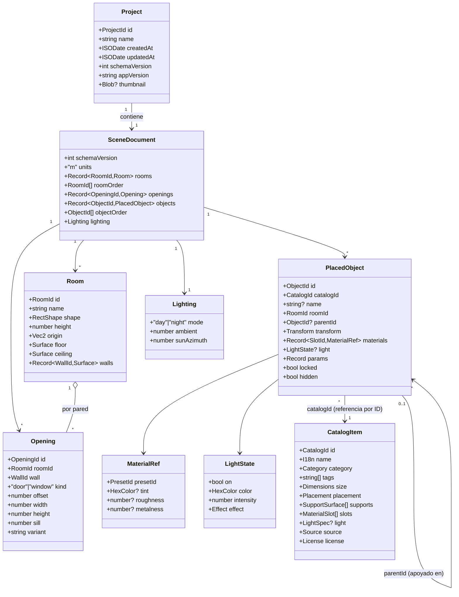
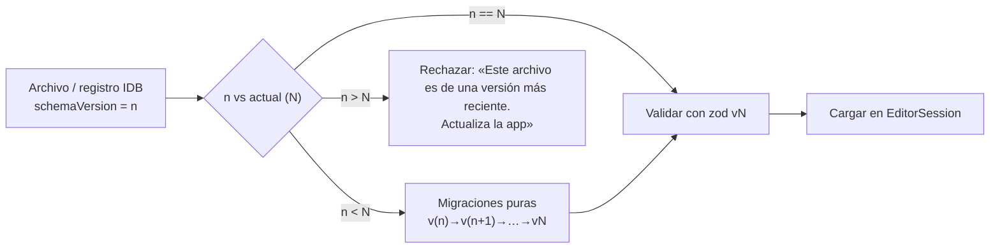

# RoomForge — Modelo de dominio

> Estado: **implementado en P2-01**. La fuente de verdad son los schemas zod de [`packages/core/src/domain`](../packages/core/src/domain/schemas.ts); los tipos de §3 se comprueban contra ellos con un test de tipos (`domain/types.test.ts`).
> Contexto: [ARCHITECTURE.md](ARCHITECTURE.md) · Evolución: [FUTURE_VERSIONS.md](FUTURE_VERSIONS.md)

## 1. Convenciones

| Tema | Convención |
|---|---|
| Unidades | **Metros** en el modelo. La UI puede mostrar cm. |
| Ejes | Sistema de mano derecha, **Y arriba** (como three.js). El suelo está en `y = 0`. |
| Origen de sala | Esquina **noroeste** de la sala = `(0, 0)`. La sala ocupa `x ∈ [0, width]`, `z ∈ [0, depth]`. Norte = `−z`. |
| Rotación de objetos | Solo **`rotationY`** (radianes, sentido antihorario visto desde arriba) en el MVP. |
| Paredes | `north` (`z=0`), `east` (`x=width`), `south` (`z=depth`), `west` (`x=0`). Los *offsets* de aperturas se miden **a lo largo de la pared en sentido horario visto desde arriba**, desde su esquina inicial. |
| IDs | Cadenas cortas (nanoid, 10 caracteres) con tipos *brand* (`ObjectId`, `RoomId`…). Cortas para que los enlaces compartidos sean pequeños. |
| Colores | Hex sRGB `#rrggbb` en el documento; la conversión a lineal ocurre en el motor. |
| Inmutabilidad | El documento es JSON puro e inmutable (Immer). Sin clases, sin funciones, sin referencias circulares. |
| Tiempos | Marcas ISO-8601 UTC en metadatos de proyecto (no en el documento). |

## 2. Mapa de entidades



> `CatalogItem` **no** es parte del documento: vive en el catálogo (manifiesto versionado con la app). El documento solo guarda `catalogId` + overrides. Esto mantiene los archivos pequeños y permite actualizar assets sin migrar proyectos.

## 3. Definiciones de tipos

```ts
// ── Identificadores ─────────────────────────────────────────────
type Brand<T, B> = T & { readonly __brand: B };
type ProjectId = Brand<string, 'ProjectId'>;
type RoomId = Brand<string, 'RoomId'>;
type ObjectId = Brand<string, 'ObjectId'>;
type OpeningId = Brand<string, 'OpeningId'>;
type CatalogId = string;            // 'desk.gaming.160'  (estable, nunca se reutiliza)
type WallId = 'north' | 'east' | 'south' | 'west';
type HexColor = `#${string}`;
type Vec2 = readonly [x: number, z: number];
type Vec3 = readonly [x: number, y: number, z: number];

// ── Documento ───────────────────────────────────────────────────
interface SceneDocument {
  schemaVersion: 1;
  units: 'm';
  rooms: Record<RoomId, Room>;
  roomOrder: RoomId[];
  openings: Record<OpeningId, Opening>;
  objects: Record<ObjectId, PlacedObject>;
  objectOrder: ObjectId[];            // orden del outliner
  lighting: Lighting;
}

interface Room {
  id: RoomId;
  name: string;
  shape: { kind: 'rect'; width: number; depth: number };   // ← unión discriminada: 'polygon' vendrá después
  height: number;
  origin: Vec2;                       // posición de la sala en el mundo (MVP: [0,0])
  floor: Surface;
  ceiling: Surface;
  walls: Record<WallId, Surface>;
}

interface Surface { material: MaterialRef }

interface Opening {
  id: OpeningId;
  roomId: RoomId;
  wall: WallId;
  kind: 'door' | 'window';
  variant: string;                    // 'door.single' | 'window.large' …
  offset: number;                     // m desde la esquina inicial de la pared hasta el borde inicial del hueco
  width: number;
  height: number;
  sill: number;                       // altura del alféizar (0 para puertas)
}

interface PlacedObject {
  id: ObjectId;
  catalogId: CatalogId;
  name?: string;
  roomId: RoomId;
  parentId: ObjectId | null;          // apoyado sobre otro objeto (monitor sobre escritorio)
  transform: { position: Vec3; rotationY: number; scale?: Vec3 };  // local al padre, o a la sala si parentId = null
  materials: Record<string /*slotId*/, MaterialRef>;
  light?: LightState;                 // solo si el item del catálogo tiene capacidad de luz
  params?: Record<string, number | string | boolean>;           // items paramétricos (p. ej. ancho)
  locked: boolean;
  hidden: boolean;
}

interface MaterialRef {
  presetId: string;                   // 'paint.matte', 'wood.oak', 'floor.concrete' …
  tint?: HexColor;
  roughness?: number;                 // 0..1 override
  metalness?: number;                 // 0..1 override
}

interface LightState {
  on: boolean;
  color: HexColor;
  intensity: number;                  // 0..1 relativo (el motor lo mapea a unidades físicas)
  effect: { kind: 'static' } | { kind: 'breathing'; speed: number } | { kind: 'cycle'; speed: number; palette?: HexColor[] };
}

interface Lighting {
  mode: 'day' | 'night';
  ambient: number;                    // 0..1
  sunAzimuth: number;                 // grados, 0..360 (MVP: preajustes)
}
```

### 3.1 Item de catálogo (manifiesto)

```ts
interface CatalogItem {
  id: CatalogId;
  name: { en: string; es: string };
  category: 'desk' | 'seating' | 'storage' | 'computing' | 'audio' | 'entertainment' | 'lighting' | 'decor';
  tags: string[];
  size: { w: number; h: number; d: number };           // metros, caja envolvente real
  placement: {
    surfaces: Array<'floor' | 'wall' | 'ceiling' | 'tabletop'>;  // permitidas; la primera es la predeterminada (p. ej. tira LED: ['wall','tabletop','floor'])
    backFace?: 'z+' | 'z-' | 'x+' | 'x-';              // cara que se apoya en la pared (wall-snap)
    defaultElevation?: number;                         // p. ej. soportes de pared
    rotationStep?: number;                             // grados (por defecto 15)
    snapToWall?: boolean;
  };
  supports?: Array<{ y: number; rect: { x: number; z: number; w: number; d: number } }>; // superficies de apoyo (escritorios)
  slots?: Array<{ id: string; label: { en: string; es: string }; default: MaterialRef }>;
  light?: { kind: 'strip' | 'bar' | 'panel' | 'point' | 'spot' | 'neon'; cost: 0 | 1 | 2; defaultColor: HexColor };
  source:
    | { kind: 'glb'; file: string; thumb: string; stats: { tris: number; bytes: number } }
    | { kind: 'parametric'; builder: string; defaults: Record<string, number | string> };
  license: { spdx: string; author: string; sourceUrl?: string };
}
```

## 4. Agregados y límites de consistencia

| Agregado | Raíz | Contiene | Regla |
|---|---|---|---|
| **Documento** | `SceneDocument` | Salas, aperturas, objetos, iluminación | Se modifica **solo** mediante Comandos; cada comando es atómico. |
| **Proyecto** | `Project` | Metadatos + documento | El repositorio guarda proyecto y documento por separado (miniatura fuera del documento). |
| **Catálogo** | `CatalogProvider` | Items | Solo lectura en runtime. |

## 5. Invariantes

Ver [ARCHITECTURE §4.3](ARCHITECTURE.md#43-invariantes-del-documento-verificados-tras-cada-comando) (I1–I7). Reglas adicionales de validación de entrada:

| Regla | Límite MVP |
|---|---|
| Ancho/fondo de sala | 2,0 – 12,0 m |
| Alto de sala | 2,2 – 4,0 m |
| Objetos por documento | ≤ 300 |
| Aperturas por pared | ≤ 6 |
| Tamaño de archivo importado | ≤ 5 MB |
| Longitud de nombres | ≤ 80 caracteres |
| Luminarias con luz real simultánea | Según calidad (4 / 8 / 12); el resto, solo emisivo |

Límites adicionales fijados en P2-01 (constante `LIMITS` en `packages/core/src/domain/limits.ts`): ≤ 16 salas; coordenadas en ±100 m; escala en (0, 10]; velocidad de efecto en (0, 10]; paleta ≤ 8 colores; ≤ 16 ranuras de material y ≤ 32 parámetros por objeto; claves e IDs de catálogo/preset ≤ 80 caracteres.

Diferencias con los tipos de §3 decididas al implementar:
- Los IDs aceptan 1–32 caracteres URL-safe (`[A-Za-z0-9_-]`; los generados tienen 10) y **no** pueden ser `__proto__`, `constructor` ni `prototype`, porque son claves de objetos del documento (lo detectó el test de propiedades).
- `Vec2`/`Vec3` son tuplas mutables en el tipo; la inmutabilidad la garantiza Immer, no el tipo.
- Los campos opcionales son *exactos*: se omiten, nunca valen `undefined` (`exactOptionalPropertyTypes`).
- Manifiesto del catálogo (P4-02, `CatalogManifestSchema` en `core/catalog`): `source` es `{ kind: 'glb', file, triangles, bytes }` (sin miniatura hasta P4-03; los paramétricos llegan con P4-05); `license` añade `origin` (procedencia en palabras) y `attribution` (texto de `docs/ATTRIBUTION.md`), y `sourceUrl` es obligatoria salvo para `LicenseRef-RoomForge-Proprietary`. Las ranuras guardan el color por defecto como `default.tint` sobre `paint.satin`. `placement` solo tiene `surfaces` de momento.
- Las puertas deben tener `sill = 0`.

## 6. Versionado y migraciones



- Cada migración: función pura `(oldDoc) => newDoc`, un archivo, con **golden test** (documento real de la versión anterior → resultado esperado).
- Cambios **aditivos** (campos opcionales) no suben `schemaVersion`; cambios de forma, sí.
- Política: **nunca perder datos** — `catalogId` desconocido se conserva y se pinta como marcador; claves desconocidas se descartan solo en imports de versiones antiguas conocidas.

## 7. Envelope de archivo (`.roomforge.json`)

```jsonc
{
  "format": "roomforge-scene",
  "formatVersion": 1,
  "appVersion": "0.4.0",
  "exportedAt": "2026-10-08T12:00:00Z",
  "project": { "name": "Mi setup" },
  "document": { "schemaVersion": 1, "units": "m", "rooms": { }, "...": "..." }
}
```

### 7.1 Importar y exportar (P6-01)

`serializeProject(project, { appVersion, exportedAt })` escribe el envelope; `parseProjectFile(texto, { catalog? })` y `parseProjectValue(valor)` (para un registro ya leído de IndexedDB o un enlace) abren un archivo. Son funciones puras de `core` que **no lanzan**: devuelven `Result<ParsedProject, ImportError>`. Código de cada fallo, en el orden en que se comprueban:

| Código | Cuándo |
|---|---|
| `TOO_LARGE` | Más de 5 MB (bytes UTF-8), sin llegar a parsearlo. |
| `INVALID_JSON` | No es JSON. |
| `HOSTILE_INPUT` | Claves `__proto__`/`constructor`/`prototype`, anidación > 32, más de 200 000 valores o un ciclo (recorrido iterativo: el coste está acotado). |
| `NOT_A_PROJECT` | JSON válido pero no es un archivo RoomForge. |
| `NEWER_VERSION` | `formatVersion` o `schemaVersion` mayores que los que conoce la app («Actualiza la app»). |
| `INVALID_VERSION` | Versión ausente o que no es un entero ≥ 0. |
| `MIGRATION_FAILED` | Una migración no pudo leer un archivo antiguo. |
| `INVALID_DOCUMENT` | zod rechaza el documento o el nombre del proyecto (`details` lista `ruta: mensaje`); las claves desconocidas se descartan. |
| `INVARIANT_VIOLATION` | Bien formado pero imposible (p. ej. un objeto fuera de su sala). |

Un `catalogId` desconocido **no** es un error: se conserva (I6) y se lista en `unknownCatalogIds`. Las migraciones viven en `serialization/migrations/` (`vN → vN+1`, autocontenidas, sin importar valores por defecto vivos) y cada una exige su *golden file* en `golden/` (documento real de la versión anterior → resultado esperado, que nunca se edita): los tests fallan si se sube `SCHEMA_VERSION` sin migración o se añade una migración sin golden. La migración v0 → v1 es de ejemplo (v0 era el formato del primer prototipo).

## 8. Camino de evolución (cómo se amplía sin romper)

| Necesidad futura | Cambio en el modelo | Impacto |
|---|---|---|
| Salas poligonales | `shape` admite `{ kind: 'polygon', points: Vec2[] }`; paredes pasan de `Record<WallId,…>` a lista de segmentos con IDs estables | Migración v2; el generador de mallas y el solver aceptan unión discriminada (por eso `kind` desde ya). |
| Varias plantas | Nueva entidad `Level { id, elevation }`; `Room.levelId` | Migración aditiva. |
| Vivienda completa | Varias `rooms` conectadas por aperturas compartidas | El mapa `rooms` y `roomOrder` ya existen. |
| Dormitorios/salones | Solo catálogo (nuevas categorías) | Sin cambios de modelo. |
| Selección múltiple | Estado de sesión (no del documento); comandos aceptan `ids[]` | Los comandos ya reciben arrays. |
| Colaboración | Los patches de Immer son el log de operaciones | Capa de transporte + resolución de conflictos (ADR futuro). |
| Escenas guardadas/vistas | `views: Record<ViewId, CameraPreset>` aditivo | Sin migración. |
| Hijos de hijos (jerarquía profunda) | Relajar I2 | Sin migración. |

## 9. Glosario

| Término | Significado |
|---|---|
| **Documento** | El estado versionado y persistente de una escena. |
| **Comando** | Operación nominal y validada que modifica el documento. |
| **Gesto** | Agrupación de interacción continua (arrastre) que produce una sola entrada de historial. |
| **Huella (footprint)** | Rectángulo orientado (OBB) del objeto en el plano del suelo. |
| **Superficie de apoyo** | Zona de un objeto sobre la que pueden colocarse otros (p. ej. tablero de escritorio). |
| **Luminaria** | Objeto del catálogo con capacidad de emitir luz (tira LED, lámpara…). |
| **Pool de luces** | Conjunto fijo de luces three.js reasignadas dinámicamente. |
| **Calidad** | Nivel gráfico (bajo/medio/alto) que determina sombras, bloom, tamaño del pool y `dpr`. |
