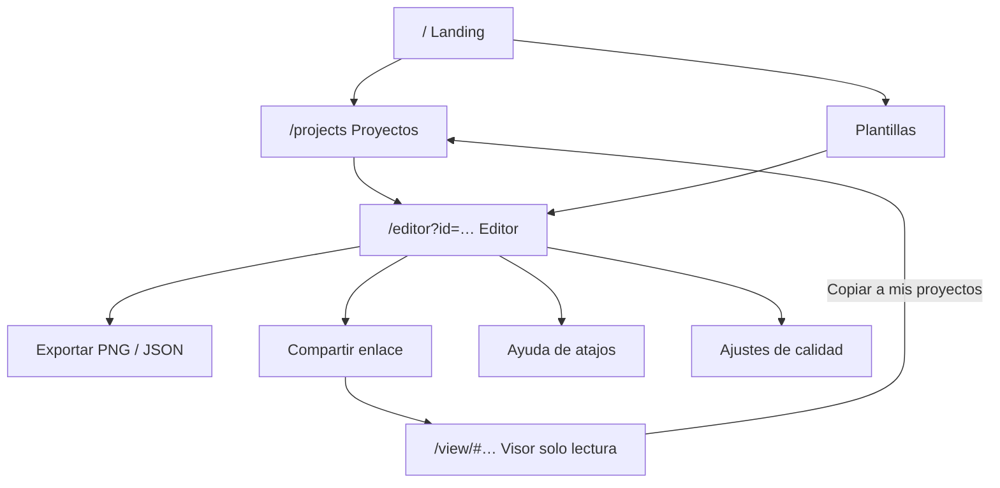

# RoomForge — Product Requirements Document (PRD)

> Estado: **borrador para aprobación** (Fase 0) · 2026-10-08 · Visión: [PRODUCT.md](PRODUCT.md) · Backlog: [BACKLOG.md](BACKLOG.md)

## 1. Resumen y objetivos

**Objetivo del MVP:** que una persona sin conocimientos 3D pueda, en menos de 10 minutos, crear una habitación o despacho gaming, amueblarla desde un catálogo, iluminarla con LED/RGB de día y de noche, guardarla en su navegador y exportarla como imagen o archivo.

**Objetivos medibles** (hipótesis; ver [PRODUCT §10](PRODUCT.md#10-métricas-de-éxito-hipótesis-a-calibrar-en-beta)):
1. Tiempo hasta el primer objeto colocado < 60 s (desde abrir el editor).
2. ≥ 45 FPS con 30 objetos + 8 luminarias en portátil con GPU integrada.
3. Cero pérdidas de datos atribuibles a la app (autoguardado + undo + export).
4. Coste de infraestructura ≈ 0 €/mes.

**No-objetivos del MVP:** planos acotados profesionales, normativa, física, renderizado fotorrealista, edición móvil, cuentas, pagos, IA, colaboración.

## 2. Alcance del MVP

| Capacidad | MVP | Notas |
|---|:---:|---|
| Crear habitación rectangular + dimensiones | ✅ P0 | 2–12 m, alto 2,2–4 m |
| Editar dimensiones | ✅ P0 | Bloquea si dejaría objetos fuera |
| Materiales de paredes/suelo/techo | ✅ P0 | ≈20 presets + tinte |
| Puertas y ventanas | 🟡 P1 | **Está en la visión pero no en la lista de MVP del brief.** Se planifica como P1 y es la primera candidata a recorte. |
| Editor 3D, cámara orbital, vista superior | ✅ P0 | |
| Catálogo (30 objetos), arrastrar y soltar | ✅ P0 | §5 |
| Seleccionar, mover, rotar, snap a rejilla/pared | ✅ P0 | |
| Colocar objetos sobre escritorios | 🟡 P1 | Imprescindible para realismo gaming |
| Propiedades del objeto y panel de escena | ✅ P0 / 🟡 P1 | Propiedades P0; outliner P1 |
| Materiales/colores de objetos | ✅ P0 | |
| Iluminación LED/RGB (color, intensidad, on/off) | ✅ P0 | |
| Efectos RGB animados (respiración, ciclo) | 🟡 P1 | |
| Modo día/noche | ✅ P0 | |
| Bloom / calidad gráfica adaptativa | 🟡 P1 / ✅ P0 | Calidad P0; bloom P1 |
| Undo/redo, atajos, autoguardado | ✅ P0 | |
| Guardado local multiproyecto | ✅ P0 | IndexedDB |
| Exportar PNG | ✅ P0 | |
| Importar/exportar JSON | ✅ P0 | |
| Compartir por enlace (visor de solo lectura) | 🟡 P1 | Vision #11; sin backend |
| Modo visor móvil | 🟡 P1 | |
| Selección múltiple | ⏳ P3 | Diseñada, no construida |
| Usuarios, pagos, marketplace, colaboración, IA | ❌ | [FUTURE_VERSIONS.md](FUTURE_VERSIONS.md) |

Leyenda: ✅ imprescindible · 🟡 importante, puede resbalar · ⏳ futuro · ❌ fuera.

## 3. Historias de usuario (selección)

| ID | Historia | Aceptación resumida |
|---|---|---|
| US-01 | Como gamer quiero crear una sala de 4×4,5 m para probar mi setup. | Asistente con presets y vista previa; sala creada y encuadrada en <5 s. |
| US-02 | Como usuario quiero arrastrar un escritorio al suelo y que se pegue a la pared. | Fantasma con validez; snap a pared; 1 entrada de historial. |
| US-03 | Como usuario quiero poner monitor y teclado sobre el escritorio. | Se apoyan a la altura del tablero; se mueven con él. |
| US-04 | Como usuario quiero rotar un objeto con una tecla o un asa. | `R` ±15°; asa; `Alt` libre. |
| US-05 | Como usuario quiero deshacer mis errores. | `Ctrl+Z` revierte la última acción completa (un arrastre = una acción). |
| US-06 | Como streamer quiero cambiar el color de una tira LED y ver cómo ilumina. | Cambio en vivo; luz real si cabe en el presupuesto, brillo si no. |
| US-07 | Como usuario quiero ver mi sala de noche con mis luces RGB. | Alternar día/noche en ≈700 ms sin tirones. |
| US-08 | Como usuario quiero que mi diseño no se pierda. | Autoguardado; recarga conserva el estado; aviso si falla. |
| US-09 | Como usuario quiero exportar una imagen bonita. | PNG 1×/2×/4×, con luces y bloom, sin rejilla. |
| US-10 | Como usuario quiero hacer una copia o llevar mi diseño a otro equipo. | Export/import JSON validado. |
| US-11 | Como usuario quiero enviar un enlace para que otros vean mi sala. | Enlace que abre un visor orbitable de solo lectura. |
| US-12 | Como usuario nuevo quiero empezar desde una plantilla. | Plantillas de calidad cargan en <3 s. |
| US-13 | Como usuario de teclado/lector de pantalla quiero operar el editor. | Outliner + atajos permiten las acciones principales. |
| US-14 | Como espectador en móvil quiero explorar la sala. | Orbitar con táctil, día/noche, ≥30 FPS. |

### Ejemplos de criterios (Dado/Cuando/Entonces)

**US-02 — Colocar con snap a pared**
- *Dado* una sala 4×4,5 m y un `desk.gaming.160` arrastrado desde el catálogo,
- *Cuando* el fantasma queda a <15 cm de la pared norte,
- *Entonces* se alinea con su cara trasera pegada a la pared, orientado hacia el interior y el fantasma se muestra como válido.
- *Y cuando* suelta el botón, *entonces* se crea el objeto con un único comando y `Ctrl+Z` lo elimina.

**US-08 — Persistencia**
- *Dado* un proyecto con 12 objetos,
- *Cuando* el usuario cierra la pestaña 1 s después de mover un objeto,
- *Entonces* al reabrir la app el objeto está en su nueva posición.

**US-11 — Enlace**
- *Dado* un proyecto con 30 objetos,
- *Cuando* pulsa «Compartir»,
- *Entonces* obtiene un enlace < 4 KB que abre la misma escena en modo solo lectura en otro navegador, sin enviar el contenido a ningún servidor.

## 4. Requisitos funcionales

Prioridad: P0 crítico · P1 importante · P2 mejora · P3 futuro (ver [WORKFLOW](WORKFLOW.md)).

| ID | Requisito | Prio | Issues |
|---|---|:---:|---|
| **Sala** | | | |
| FR-ROOM-01 | Crear una sala rectangular con ancho, fondo y alto (con presets). | P0 | P2-04, P3-10 |
| FR-ROOM-02 | Editar dimensiones; bloquear si objetos/aperturas quedarían fuera y mostrar conflictos. | P0 | P2-04, P3-10 |
| FR-ROOM-03 | Cambiar material/color de suelo, techo y cada pared. | P0 | P5-01, P5-02, P5-03 |
| FR-ROOM-04 | Añadir, mover, redimensionar y eliminar puertas y ventanas (4 variantes). | P1 | P3-11, P3-12 |
| **Cámara y vistas** | | | |
| FR-CAM-01 | Cámara orbital con zoom y desplazamiento. | P0 | P2-08 |
| FR-CAM-02 | Vista superior ortográfica; transición suave; encuadrar sala. | P0 | P2-08 |
| FR-CAM-03 | Modos de pared (arriba/corte/abajo) y techo oculto en edición. | P1 | P2-10 |
| **Objetos** | | | |
| FR-OBJ-01 | Catálogo de 30 objetos con búsqueda y categorías. | P0 | P3-06, P4-02, P4-06, P4-07, P4-08, P4-09, P4-10 |
| FR-OBJ-02 | Arrastrar y soltar desde el catálogo con fantasma de colocación. | P0 | P3-06 |
| FR-OBJ-03 | Seleccionar por clic; hover; contorno; deseleccionar. | P0 | P3-03 |
| FR-OBJ-04 | Mover con snap a rejilla (5/10/25/50 cm) y a pared; límites de sala. | P0 | P3-01, P3-02, P3-04 |
| FR-OBJ-05 | Rotar con teclas, asa y paso angular. | P0 | P3-05 |
| FR-OBJ-06 | Panel de propiedades (nombre, posición, rotación, bloqueo, visibilidad). | P0 | P3-07 |
| FR-OBJ-07 | Colocar objetos sobre superficies de apoyo (monitor sobre escritorio). | P1 | P3-13 |
| FR-OBJ-08 | Duplicar y eliminar objetos. | P0 | P3-02, P3-07, P3-08 |
| FR-OBJ-09 | Avisos de colisión y fuera de límites. | P2 | P3-14 |
| FR-OBJ-10 | Panel de escena (outliner): seleccionar, renombrar, ocultar, bloquear. | P1 | P3-15 |
| FR-OBJ-11 | Carga perezosa de modelos con placeholder y reintento. | P0 | P4-04 |
| **Materiales e iluminación** | | | |
| FR-MAT-01 | Materiales por ranura de objeto con presets y tinte. | P0 | P5-01, P5-02, P5-03 |
| FR-LIT-01 | Luminarias RGB: encender/apagar, color, intensidad. | P0 | P5-04, P5-05, P5-09 |
| FR-LIT-02 | Efectos RGB: estático, respiración, ciclo. | P1 | P5-04, P5-08 |
| FR-LIT-03 | Modo día/noche con transición. | P0 | P5-06, P5-09 |
| FR-LIT-04 | Resplandor (bloom) en emisivos. | P1 | P5-07 |
| FR-LIT-05 | Presets de ambiente y control global de luces. | P0 | P5-04, P5-09 |
| FR-LIT-06 | Calidad gráfica (baja/media/alta/auto). | P0 | P5-10 |
| **Experiencia** | | | |
| FR-UX-01 | Undo/redo con etiquetas; un gesto = una entrada. | P0 | P2-03, P3-08 |
| FR-UX-02 | Atajos de teclado y ayuda (`?`). | P0 | P3-08 |
| FR-UX-03 | Snap activable y configurable desde la barra inferior. | P0 | P3-09 |
| FR-UX-04 | Interfaz responsive; editor en escritorio; visor en móvil. | P0 / P1 | P1-06, P7-06 |
| FR-UX-05 | Plantillas de inicio y tutorial. | P0 | P8-02 |
| FR-UX-06 | Accesibilidad por teclado/lector de pantalla. | P1 | P3-15, P7-05 |
| **Persistencia y exportación** | | | |
| FR-PER-01 | Guardado local automático y recuperación de sesión. | P0 | P6-02, P6-03 |
| FR-PER-02 | Gestión de proyectos (listar, crear, renombrar, duplicar, borrar con deshacer). | P0 | P6-04 |
| FR-PER-03 | Exportar/importar JSON versionado y validado. | P0 | P6-01, P6-05 |
| FR-PER-04 | Robustez de almacenamiento (cuota, persist, multi-pestaña, copia). | P2 | P6-09 |
| FR-EXP-01 | Exportar PNG (1×/2×/4×, transparente, sin ayudas). | P0 | P6-06 |
| FR-EXP-02 | Miniaturas de proyecto. | P1 | P6-07 |
| FR-SHR-01 | Compartir por enlace en el fragmento de URL + visor de solo lectura. | P1 | P6-08 |
| **Plataforma** | | | |
| FR-OPS-01 | Landing, páginas legales, analítica sin cookies. | P0 | P8-01 |
| FR-OPS-02 | Feedback in-app y triage. | P1 | P8-04 |
| FR-OPS-03 | Resiliencia: errores, pérdida de contexto WebGL, fallo sin WebGL. | P0 | P7-08, P7-07 |
| FR-OPS-04 | Offline/PWA. | P2 | P8-05 |

## 5. Catálogo del MVP (30 objetos)

Dimensiones orientativas en metros (ancho × alto × fondo). Nombres **genéricos** (sin marcas). «Vía» es la hipótesis de producción a confirmar en **P4-01**: **P** = paramétrico en código, **G** = GLB (CC0 o propio).

| # | ID de catálogo | Nombre | Categoría | Superficies | Dimensiones | Luz | Vía | Lote |
|---:|---|---|---|---|---|:---:|:---:|:---:|
| 1 | `desk.office.140` | Escritorio de oficina 140 | Escritorio | suelo | 1,40×0,74×0,70 | | P | A |
| 2 | `desk.gaming.160` | Escritorio gaming 160 | Escritorio | suelo | 1,60×0,75×0,75 | | P | A |
| 3 | `desk.corner.l` | Escritorio en L | Escritorio | suelo | 1,80×0,75×1,50 | | P | A |
| 4 | `chair.gaming` | Silla gaming | Asiento | suelo | 0,68×1,30×0,70 | | G | A |
| 5 | `chair.office` | Silla de oficina | Asiento | suelo | 0,62×1,00×0,62 | | G | A |
| 6 | `monitor.27` | Monitor 27" | Informática | escritorio | 0,61×0,45×0,20 | | P | B |
| 7 | `monitor.ultrawide.34` | Monitor ultrawide 34" | Informática | escritorio | 0,81×0,45×0,25 | | P | B |
| 8 | `laptop.generic` | Portátil | Informática | escritorio | 0,33×0,23×0,24 | | P/G | B |
| 9 | `pc.tower.rgb` | Torre de PC con RGB | Informática | suelo, escritorio | 0,22×0,48×0,46 | ✔ | P | B |
| 10 | `keyboard.mechanical` | Teclado mecánico | Informática | escritorio | 0,44×0,04×0,14 | ✔ | P | B |
| 11 | `mouse.deskmat` | Ratón y alfombrilla | Informática | escritorio | 0,80×0,02×0,30 | | P | B |
| 12 | `speakers.pair` | Altavoces (par) | Audio | escritorio | 0,60×0,20×0,14 | | P | B |
| 13 | `headset.stand` | Auriculares con soporte | Audio | escritorio | 0,10×0,30×0,12 | | P/G | B |
| 14 | `mic.boomarm` | Micrófono con brazo | Audio | escritorio | 0,15×0,35×0,30 | | P/G | B |
| 15 | `shelf.bookcase` | Estantería | Almacenaje | suelo | 0,80×1,80×0,30 | | P | C |
| 16 | `drawer.pedestal` | Cajonera con ruedas | Almacenaje | suelo | 0,40×0,60×0,50 | | P | C |
| 17 | `shelf.wall` | Estante de pared | Almacenaje | pared | 0,80×0,04×0,20 | | P | C |
| 18 | `cabinet.sideboard` | Aparador | Almacenaje | suelo | 1,20×0,75×0,40 | | P | C |
| 19 | `tv.55` | TV 55" | Entretenimiento | escritorio, suelo | 1,23×0,77×0,20 | | P | C |
| 20 | `console.generic` | Consola con mando | Entretenimiento | escritorio | 0,30×0,07×0,25 | ✔ | P/G | C |
| 21 | `beanbag.round` | Puf | Asiento | suelo | 0,90×0,70×0,90 | | G | C |
| 22 | `led.strip` | Tira LED (longitud 0,5–3 m) | Iluminación | pared, escritorio, suelo | L×0,01×0,01 | ✔ | P | D |
| 23 | `light.bars.pair` | Barras de luz (par) | Iluminación | escritorio, suelo | 0,04×0,45×0,04 (×2) | ✔ | P | D |
| 24 | `panel.hex` | Paneles hexagonales | Iluminación | pared | 0,45×0,45×0,02 | ✔ | P | D |
| 25 | `lamp.floor` | Lámpara de pie | Iluminación | suelo | 0,30×1,60×0,30 | ✔ | P/G | D |
| 26 | `lamp.desk` | Lámpara de escritorio | Iluminación | escritorio | 0,20×0,45×0,20 | ✔ | P/G | D |
| 27 | `neon.sign` | Neón decorativo (forma genérica) | Iluminación | pared | 0,60×0,30×0,03 | ✔ | P | D |
| 28 | `plant.potted` | Planta en maceta | Decoración | suelo | 0,40×1,00×0,40 | | G | C |
| 29 | `rug.rect` | Alfombra rectangular | Decoración | suelo | 2,00×0,01×1,40 | | P | C |
| 30 | `frame.poster` | Marco / póster | Decoración | pared | 0,50×0,70×0,03 | | P | C |

Aperturas (fuera de los 30): puerta simple, puerta doble, ventana estándar, ventana grande (paramétricas, P3-12).

Requisitos transversales del catálogo: dimensiones reales; `supports` en escritorios/aparador; ranuras de material; licencia y autoría por item; presupuestos de [R3F_PERFORMANCE §3](research/R3F_PERFORMANCE.md).

## 6. Reglas de negocio y límites

| Regla | Valor |
|---|---|
| Lado de sala | 2,0 – 12,0 m |
| Altura | 2,2 – 4,0 m |
| Objetos por documento | ≤ 300 |
| Aperturas por pared | ≤ 6 |
| Snap de posición | 5 / 10 / 25 / 50 cm (defecto 10) |
| Snap angular | 15° (defecto), 45°, 90°, libre con `Alt` |
| Tamaño de archivo importado | ≤ 5 MB |
| Enlace de compartir | objetivo < 4 KB; tope 16 KB |
| Luces reales simultáneas | 4 (baja) / 8 (media) / 12 (alta) |
| Historial | 200 entradas |
| Proyectos locales | sin límite fijo (sujeto a cuota del navegador) |

## 7. Requisitos no funcionales

| ID | Categoría | Requisito | Verificación |
|---|---|---|---|
| NFR-PERF-01 | Rendimiento | ≥ 45 FPS con 30 objetos + 8 luminarias (calidad media) en portátil con GPU integrada; ≥ 30 FPS en visor móvil. | P7-03, P7-04 |
| NFR-PERF-02 | Rendimiento | Arrastrar un objeto mantiene 60 fps con 50 objetos; sin asignaciones por frame en el camino caliente. | P3-04 |
| NFR-PERF-03 | Rendimiento | Reposo = 0 frames renderizados (`frameloop="demand"`). | P2-06 |
| NFR-PERF-04 | Carga | JS inicial del editor ≤ 450 kB gz; catálogo inicial ≤ 3 MB; p75 a editor interactivo ≤ 5 s (4G rápido, caché fría). | P7-03, P7-04 |
| NFR-REL-01 | Fiabilidad | Ninguna pérdida de datos atribuible a la app; pérdida de contexto WebGL recuperable. | P6-03, P7-08 |
| NFR-REL-02 | Fiabilidad | Undo/redo: `undo` total ⇒ documento original (propiedad). | P2-03, P3-02 |
| NFR-SEC-01 | Seguridad | Toda entrada importada/enlazada se valida; CSP estricta; sin `eval`. | P6-01, P7-09 |
| NFR-PRIV-01 | Privacidad | Sin cuentas ni PII; el contenido de proyectos no sale del navegador; analítica sin cookies. | P8-01 |
| NFR-A11Y-01 | Accesibilidad | WCAG 2.2 AA en UI; alternativa por teclado al canvas. | P3-15, P7-05 |
| NFR-I18N-01 | Internacionalización | Textos externalizados; idiomas del MVP según Q1. | P1-05 |
| NFR-COMPAT-01 | Compatibilidad | Ver matriz inferior. | P7-07 |
| NFR-MAINT-01 | Mantenibilidad | Cobertura `core` ≥ 90 % líneas; fronteras de módulos verificadas en CI. | P1-02, P7-03 |
| NFR-COST-01 | Coste | Infraestructura ≈ 0 €/mes (solo dominio). | DEPLOYMENT |

### Matriz de compatibilidad (objetivo; se actualiza en P7-07)

| Plataforma | Soporte | Notas |
|---|---|---|
| Chrome / Edge (últimas 2 versiones, escritorio) | Editor completo | Referencia de desarrollo |
| Firefox (últimas 2, escritorio) | Editor completo | Verificar WebGL/IndexedDB |
| Safari 17+ (macOS) | Editor completo | Riesgo de desalojo de almacenamiento ⇒ avisos de copia |
| Safari iOS 17+ / Chrome Android | **Visor** | Edición no soportada en MVP |
| Navegadores sin WebGL 2 | Pantalla de fallo | Exportar JSON como salida |

Hardware de referencia: portátil con GPU integrada moderna (modelo concreto a fijar en Q7) y móvil de gama media.

## 8. Pantallas y flujos

| Pantalla | Estados clave |
|---|---|
| Landing | Hero, demo, CTA «Probar ahora», legal |
| Proyectos | Vacío, lista, borrado con deshacer, importar |
| Editor | Cargando, vacío (asistente de sala), edición, guardando/error, fallo WebGL |
| Visor | Cargando, ok, enlace inválido/truncado, versión nueva |

## 9. Fuera de alcance (documentado)

Pagos, marketplace, usuarios, colaboración en tiempo real, generación con IA, backend complejo, salas poligonales, varias plantas, dormitorios/salones/viviendas, física, AR, importación de modelos propios, exportación glTF/USDZ. Detalle y puntos de extensión en [FUTURE_VERSIONS.md](FUTURE_VERSIONS.md).

## 10. Preguntas abiertas

Cada una tiene una **propuesta por defecto** con la que se procederá salvo que se indique lo contrario. Q1–Q3 bloquean el inicio de la Fase 1 (P0-02).

| ID | Pregunta | Propuesta por defecto | Bloquea |
|---|---|---|---|
| **Q1** | ¿Idiomas de la UI en el MVP? | **EN + ES**, textos externalizados desde P1-05. Documentación y issues en español; código, commits y PRs en inglés. | P1-05 |
| **Q2** | ¿Nombre final, dominio y marca? («RoomForge» no se ha comprobado en registros de marcas ni de dominios.) | Mantener RoomForge provisionalmente; comprobar dominio/marca antes de P8-03. | P0-03 (nombre del repo), P8-03 |
| **Q3** | ¿Visibilidad y licencia del repositorio/código? | Repo **privado** y «todos los derechos reservados» hasta decidir. | P0-03 |
| Q4 | ¿Dirección artística? | Estilizado limpio (low-poly con PBR simple), confirmado por el spike P4-01. | P4-01 |
| Q5 | ¿Puertas/ventanas dentro del MVP? | P1 (candidatas a recorte). | Roadmap |
| Q6 | ¿Herramienta de analítica sin cookies? | Evaluar Cloudflare Web Analytics / Plausible / Umami; o ninguna en la beta. | P8-01 |
| Q7 | ¿Cuál es el hardware de referencia real (portátil y móvil)? | A indicar por el propietario. | P7-04 |
| Q8 | ¿Unidades? | Métrico; conmutador imperial P3. | — |
| Q9 | ¿Hay acceso a Codex cloud para el repo y qué política de aprobación aplica a `main`? | Sin protecciones de GitHub (decisión del propietario, 2026-10-08): `main` lo fusiona el propietario y producción se despliega a mano (ver [ADR-0009](ADR/0009-git-workflow.md)). | P1-09 |
| Q10 | ¿Se confirma posponer IA y monetización a tras la beta? | Sí (Fase 9 se planifica con datos de uso). | Roadmap |

### Decisiones tomadas

**2026-10-08 — aprobación global en el chat («dale con esto»)** tras revisar el resumen de la Fase 0: se aceptan las propuestas por defecto de la tabla anterior. En concreto:

| ID | Decisión |
|---|---|
| Q1 | UI en **EN + ES** con textos externalizados. Documentación e issues en español; código, commits y PRs en inglés. |
| Q2 | Nombre **RoomForge** provisional; repositorio `MarcSagues/room-forge`. Comprobar dominio y marca antes de P8-03. |
| Q3 | Repositorio **privado**; licencia «todos los derechos reservados» hasta decidir. |
| Q4, Q5, Q6, Q8, Q10 | Se mantienen las propuestas por defecto (estilo estilizado a confirmar en P4-01; puertas/ventanas P1; analítica a decidir en P8-01; métrico; IA y monetización tras la beta). |
| Q7 | **Abierta**: falta indicar el portátil y el móvil de referencia (necesario antes de P2-11 y P7-04). |
| Q9 | **Abierta**: confirmar acceso a Codex cloud para el repo (P1-09). Producción: despliegue manual por el propietario, sin Environments ([ADR-0009](ADR/0009-git-workflow.md)). **Decidido:** ni GitHub Pro ni repo público. |

Cualquiera de estas decisiones puede revisarse reabriendo la issue P0-02.

## 11. Criterios de aceptación del MVP (puerta de salida de la Fase 7)

- [ ] Todas las issues P0 de M1–M7 cerradas; las P1 cerradas o con recorte explícito aprobado.
- [ ] Recorrido E2E «sala → objetos → luz RGB → día/noche → guardar → recargar → PNG → JSON → enlace» verde en CI, 20 repeticiones.
- [ ] NFR-PERF-01..04 verificados con cifras en `docs/perf/`.
- [ ] 0 violaciones graves de axe; operación por teclado de la sesión típica.
- [ ] Sin vulnerabilidades altas/críticas abiertas; CSP activa.
- [ ] 30 items de catálogo con licencia válida y presupuestos cumplidos.
- [ ] Documentación actualizada (README, ARCHITECTURE si cambió, ADR aceptadas).
