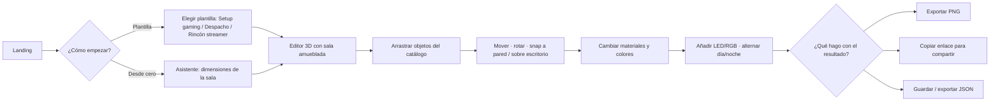

# RoomForge — Visión de producto

> Estado: **borrador para aprobación** (Fase 0) · Última actualización: 2026-10-08
> Documentos relacionados: [PRD](PRD.md) · [Arquitectura](ARCHITECTURE.md) · [Roadmap](ROADMAP.md) · [Riesgos](RISKS.md)

## 1. Qué es RoomForge

RoomForge es una aplicación web para **diseñar habitaciones, despachos y setups gaming en 3D** directamente en el navegador, sin instalar nada y sin saber modelado 3D. Combina la facilidad de colocar objetos de un juego de construcción con herramientas de diseño reales (dimensiones, materiales, iluminación) y una **simulación de iluminación LED/RGB** como característica de primera clase.

**Frase de producto:** *«Diseña tu setup antes de comprarlo. Míralo de día, de noche y con tus luces RGB.»*

## 2. Problema y oportunidad

| Problema | Hoy | Oportunidad RoomForge |
|---|---|---|
| Planificar un setup gaming/despacho es difícil de imaginar: medidas, cables, dónde cae la luz, cómo se ve de noche. | Se improvisa con capturas, cinta métrica o planificadores de hogar genéricos. | Un simulador rápido, centrado en escritorios, monitores, luces y ambiente. |
| Los planificadores de hogar genéricos son potentes pero pesados: orientados a planos y reformas, catálogos poco gaming, iluminación LED casi inexistente. | Planner 5D, RoomSketcher, Floorplanner, Homestyler, IKEA Kreativ (ver §7). | Producto **gaming-first**, ligero, con la iluminación RGB como protagonista. |
| Compartir un setup se reduce a una foto. | Fotos en Reddit/Discord. | Enlace a una escena 3D explorable + imagen exportada. |

> Nota de honestidad: la comparativa competitiva se basa en reseñas y páginas públicas (varias con intereses comerciales). **No hemos probado en profundidad cada herramienta.** La hipótesis de diferenciación debe validarse con usuarios reales durante la beta (Fase 8).

## 3. Usuarios objetivo

| Persona | Contexto | Necesita | Prioridad |
|---|---|---|---|
| **Álex, gamer de setup** (18–30) | Quiere montar o renovar su rincón gaming. Mira r/battlestations. | Probar disposiciones, ver cómo queda con luces RGB, compartirlo. | **Primaria** |
| **Sam, streamer / creador** | Cuida fondo de cámara, luz de cara, ambiente. | Probar paletas de color, posición de cámara/luces, exportar imagen de calidad. | **Primaria** |
| **Noa, teletrabajadora / despacho** | Despacho en casa en una habitación pequeña. | Que quepa todo, ergonomía básica, orden. | Secundaria |
| **Espectador** | Recibe un enlace. | Abrir, orbitar, entender. En móvil. | Secundaria (modo visor) |

Fuera de foco inicial: arquitectos/interioristas profesionales, planos acotados para reformas, normativa.

## 4. Propuesta de valor y diferenciadores

1. **Gaming-first.** Catálogo de escritorios, monitores (incl. ultrawide), torres con RGB, sillas gaming, soportes, consolas, luces… no 3.000 sofás.
2. **Iluminación LED/RGB simulada de verdad.** Tiras, barras, paneles, neones; color, intensidad, efectos; modo día/noche. Es el «momento wow» del producto.
3. **Sensación de videojuego de construcción.** Arrastrar, soltar, girar, que se pegue a la pared, que se apoye en el escritorio. Cero fricción.
4. **Cero fricción de acceso.** Abre y diseña: sin cuenta, sin instalación, **local-first** (tus datos en tu navegador).
5. **Compartible.** Exportar PNG, JSON y enlaces.
6. **Rápido y ligero.** Debe funcionar fluido en un portátil integrado, no solo en una GPU dedicada.

## 5. Principios de producto

1. **Tiempo hasta el «wow» < 60 s.** Desde abrir la web hasta ver una habitación amueblada e iluminada. Plantillas y defaults bonitos.
2. **Nunca perder el trabajo.** Autoguardado, undo/redo fiable, exportación fácil. Un bug de pérdida de datos es P0 siempre.
3. **El 3D es un medio, no el objetivo.** El usuario no debe pensar en ejes, mallas ni materiales PBR.
4. **Defaults bonitos, control opcional.** Todo se ve bien sin tocar nada; todo es ajustable si se quiere.
5. **El editor es de escritorio; la vista es de todos.** Editor para desktop; móvil = visualizar y explorar (inicialmente).
6. **Simplicidad técnica.** Coste mínimo, sin microservicios, sin backend en el MVP.

## 6. Viaje de usuario principal (primeros 5 minutos)

## 7. Panorama competitivo (resumen)

| Herramienta | Fortaleza declarada | Limitación para nuestro caso |
|---|---|---|
| Planner 5D | Decoración visual 2D/3D, web y móvil. | Catálogo generalista; exportaciones limitadas en gratuito; poca simulación LED. |
| RoomSketcher | Planos medidos y profesionales. | Orientado a planos/reformas; no gaming. |
| Floorplanner | Editor en navegador, 2D/3D. | Gratuito con proyectos limitados y marca de agua. |
| Homestyler | Visuales/renders pulidos. | Enfoque hogar/interiorismo. |
| IKEA Kreativ | Probar muebles IKEA sobre una sala real. | Atado al catálogo IKEA. |

Fuentes públicas consultadas: [comparativa de software de planos (SpaceDesigner3D)](https://www.spacedesigner3d.com/blog/best-online-floor-plan-software), [Planner 5D vs RoomSketcher (blog de RoomSketcher — parte interesada)](https://www.roomsketcher.com/blog/planner5d-vs-roomsketcher/), [guía de espacios gaming (Home Depot)](https://www.homedepot.com/c/ab/how-to-create-a-gaming-space/9ba683603be9fa5395fab9017685a994). Las reseñas agregadas tienen vínculos comerciales; tómese como orientación, no como evidencia.

**Posicionamiento:** *el planificador 3D especializado en setups gaming y despachos, con simulación de iluminación RGB y sensación de juego.* No competimos en precisión de planos de obra.

## 8. Referencias de UX (inspiración, no copia)

| Referencia | Qué tomamos (abstracto) | Qué NO copiamos |
|---|---|---|
| **Figma** | Paneles laterales claros, propiedades en panel derecho, campos numéricos «arrastrables», atajos, paleta de comandos. | Su identidad visual, lienzo infinito 2D. |
| **The Sims** | Colocación directa por arrastre, vista de corte de paredes, rotación sencilla, snap a paredes. | Estética y metáforas de juego (modo compra/construcción). |
| **Meshy AI** | Presentación del 3D: visor limpio, fondo neutro, iluminación cuidada, miniaturas. | Flujo de generación IA (futuro). |
| **Linear** | Claridad, minimalismo, densidad cuidada, teclado primero, microinteracciones sobrias. | Su paleta y su tipografía exacta. |

La identidad propia se define en [DESIGN_SYSTEM.md](DESIGN_SYSTEM.md): UI sobria en neutros fríos con acento «ember» (cálido) para que **los colores RGB de la escena sean los protagonistas**.

## 9. Alcance por versión

| Versión | Contenido | Documento |
|---|---|---|
| **MVP (v0.x, Fases 1–7)** | Habitación rectangular, editor 3D, catálogo de 30 objetos, materiales básicos, iluminación RGB, día/noche, guardado local, PNG, JSON, undo/redo. | [PRD](PRD.md) |
| **Beta pública (v0.1-beta, Fase 8)** | Landing, plantillas, tutorial, analítica respetuosa, despliegue de producción. | [ROADMAP](ROADMAP.md) |
| **v1 (Fase 9)** | Cuentas, sincronización, enlaces alojados, generación de distribuciones con IA, planes y pagos. | [FUTURE_VERSIONS](FUTURE_VERSIONS.md) |
| **v2+** | Marketplace, colaboración en tiempo real, habitaciones poligonales, varias plantas, dormitorios/salones/viviendas. | [FUTURE_VERSIONS](FUTURE_VERSIONS.md) |

## 10. Métricas de éxito (hipótesis a calibrar en beta)

| Métrica | Definición | Objetivo inicial |
|---|---|---|
| **Activación** | % de sesiones nuevas que colocan ≥1 objeto en <60 s | ≥ 60 % |
| **Estrella polar** | Proyectos guardados con ≥10 objetos y ≥1 luz, por semana | Crecimiento sostenido |
| **Retención D7** | Usuarios que vuelven a abrir un proyecto a los 7 días | ≥ 20 % |
| **Compartir** | % de proyectos exportados (PNG/JSON/enlace) | ≥ 25 % |
| **Rendimiento** | FPS p50 en portátil de referencia (GPU integrada), escena de 30 objetos + 8 luces | ≥ 45 FPS |
| **Carga** | Tiempo hasta editor interactivo (p75, 4G rápido, caché fría) | ≤ 5 s |
| **Fiabilidad** | Sesiones sin error irrecuperable | ≥ 99 % |

Medición: analítica de eventos **sin datos personales** (Fase 8). Los objetivos son hipótesis; se revisan tras la beta.

## 11. Modelo de negocio (hipótesis, **no implementar en MVP**)

- **Gratis:** editor completo local-first, catálogo base, PNG estándar, JSON.
- **Pro (futuro):** sincronización en la nube, enlaces alojados con vista previa, exportes en alta resolución sin marca, créditos de IA, packs premium.
- **Marketplace (futuro lejano):** packs de creadores.
- **Costes MVP:** ≈ 0 €/mes (hosting estático gratuito). Único gasto previsible: dominio (~10–15 €/año). Ver [DEPLOYMENT.md](DEPLOYMENT.md).

## 12. Supuestos y dependencias clave

| # | Supuesto | Cómo se valida |
|---|---|---|
| S1 | Podemos conseguir/crear ~30 assets 3D con calidad visual coherente y licencia limpia a coste ≈ 0. | Spike P4-01 (Fase 4). **Riesgo #1.** |
| S2 | WebGL2 con luces dinámicas limitadas es suficiente para un resultado atractivo en GPU integrada. | Presupuestos y spikes en Fases 2 y 5. |
| S3 | Hay demanda de una herramienta gaming-first frente a planificadores generalistas. | Beta pública y analítica. |
| S4 | Local-first sin cuenta es aceptable para el MVP. | Feedback de beta. |
| S5 | El hosting estático gratuito soporta el tráfico de la beta. | Monitorización; ver DEPLOYMENT. |

Las preguntas abiertas que requieren decisión humana están en [PRD §10](PRD.md#10-preguntas-abiertas).
