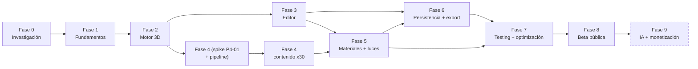

# RoomForge — Roadmap por fases

> Estado: **borrador para aprobación** · 2026-10-08
> Las cifras de esfuerzo salen de `docs/issues/*.md` (tabla completa y orden de implementación en [BACKLOG.md](BACKLOG.md), generado por `tools/planning/github-import.mjs`).

## 1. Resumen

| Fase | Hito | Objetivo en una línea | Issues | Esfuerzo (días ideales) | Puerta de salida |
|---|---|---|---:|---:|---|
| 0 | M0 | Investigar, decidir y preparar el repositorio | 3 | 1,25 | Docs aprobadas, repo creado, backlog importado |
| 1 | M1 | Repositorio con calidad automatizada, CI y shell del editor | 9 | 6,5 | `pnpm check` verde en CI; preview desplegada |
| 2 | M2 | Núcleo de dominio + motor de escena base | 11 | 10,5 | Sala renderizada, orbitar, undo/redo por comandos, 0 frames en reposo |
| 3 | M3 | Editor interactivo: colocar, mover, rotar, propiedades, atajos | 15 | 20 | Un usuario nuevo coloca 5 objetos y deshace sin ayuda |
| 4 | M4 | 30 objetos con pipeline y licencias limpias | 10 | 14 | Catálogo completo dentro de presupuesto |
| 5 | M5 | Materiales, luces RGB, día/noche, calidad | 10 | 12 | ≥45 FPS con 30 objetos + 8 luces; sin recompilar al cambiar luces |
| 6 | M6 | Guardar, importar/exportar, PNG, enlaces | 9 | 10,5 | Recarga conserva todo; PNG/JSON/enlace funcionan |
| 7 | M7 | E2E, visual, presupuestos, accesibilidad, móvil, seguridad | 9 | 10,5 | Puerta de salida del MVP (PRD §11) |
| 8 | M8 | Beta pública | 6 | 6 | URL pública; 10 usuarios completan el flujo |
| 9 | M9 | IA, nube, pagos, marketplace (post-MVP) | 9 | 28 | Planificada con datos de la beta |
| | | **MVP + beta (M0–M8)** | **82** | **91,25** | |

Esfuerzo = «días ideales de desarrollo asistido por IA» (XS 0,25 · S 0,5 · M 1 · L 2 · XL 4), incluyendo tests, PR y una ronda de revisión. **No son días de calendario.**

## 2. Diagrama de dependencias entre fases

Las Fases 3 y 4 pueden solaparse tras la Fase 2 (editor en una pista, contenido en otra).

**Ruta crítica del MVP** (por dependencias, 20,25 días si hubiese paralelismo perfecto): `P0-01 → P0-03 → P1-01 → P1-03 → P2-01 → P2-02 → P2-06 → P2-07 → P4-01 → P4-03 → P4-10 → P5-05 → P5-06 → P6-06 → P7-01 → P7-07`.
Lectura: **catálogo/assets → luces → export PNG → E2E** es el camino que más limita el calendario; por eso el spike de assets (P4-01) y el de luces (P2-11) se adelantan.

## 3. Estimación de calendario (baja confianza — recalibrar tras la Fase 2)

No hay datos de velocidad todavía. Se muestran tres escenarios sobre los 91,25 días ideales de M0–M8:

| Escenario | Factor | Días de trabajo | Semanas a 5 d/sem | Semanas a 2,5 d/sem |
|---|---:|---:|---:|---:|
| Optimista | ×1,0 | 91 | ≈ 18 | ≈ 36 |
| **Esperado** | ×1,4 | 128 | ≈ 26 | ≈ 51 |
| Pesimista | ×2,0 | 183 | ≈ 37 | ≈ 73 |

El factor esperado cubre integración, bugs, revisiones y desconocidos (assets y luces son los mayores). **Tras la Fase 2 (≈ 18 días ideales) se mide la velocidad real y se reajusta este cuadro.** El cuello de botella suele ser la **revisión humana**, no la implementación: ver §7.

## 4. Fases en detalle

### Fase 0 — Investigación y arquitectura (M0)
- **Objetivo:** decidir stack, arquitectura y alcance; dejar el trabajo listo para ejecutar sin ambigüedad.
- **Funcionalidades:** ninguna (documentación). Las acciones humanas pendientes: P0-01, P0-02, P0-03.
- **Dependencias:** ninguna.
- **Riesgos:** decisiones sin validar con datos (R3, R17); alcance difuso (R3).
- **Criterios de aceptación:** ADR aceptadas; PRD con Q1–Q3 resueltas; repositorio con `develop`/`main`, ajustes de repo, labels, milestones e issues importadas (sin protecciones de GitHub por decisión del propietario).
- **Estimación:** 1,25 d (humano) + planificación ya realizada.
- **Entregables:** `docs/` completa, `.github/`, `docs/issues/`, `tools/planning/`, repositorio remoto.

### Fase 1 — Fundamentos del proyecto (M1)
- **Objetivo:** iterar con feedback rápido y seguro.
- **Funcionalidades:** monorepo pnpm; Next 16 export estático; Biome + dependency-cruiser + hooks; Vitest/RTL; CI; Tailwind v4 + shadcn + tokens; shell del editor; Playwright con WebGL; previews en Cloudflare; Codex activo.
- **Dependencias:** Fase 0; cuenta y token de Cloudflare (humano).
- **Riesgos:** TypeScript 7 / toolchain (R9); WebGL en CI inestable (R16); fricción Next+Cloudflare (R9, R12).
- **Criterios de aceptación:** `pnpm check` verde local y CI; PR de prueba con preview y revisión de Codex; shell correcto a 1280/1024/768 px.
- **Estimación:** 6,5 d.
- **Entregables:** repo funcional, CI, previews, shell vacío, ADR-0008/0009 confirmadas.

### Fase 2 — Motor 3D (M2)
- **Objetivo:** el corazón técnico: dominio, comandos, historial y render bajo demanda.
- **Funcionalidades:** schemas zod; `EditorSession`; comandos con patches; undo/redo con coalescing y gestos; comandos de sala; eventos y selección; Canvas R3F bajo demanda; `RoomMesh`; `CameraRig`; patrón `EntityView`; modos de pared; spike de iluminación.
- **Dependencias:** Fase 1.
- **Riesgos:** corrección de undo/redo (R15); rendimiento de R3F + Next (R2, R21); modelo de dominio inadecuado (R6).
- **Criterios de aceptación:** `core` ≥ 90 % cobertura; 0 frames en reposo; 1 re-render al mover 1 de 500 entidades; informe del spike de luces.
- **Estimación:** 10,5 d.
- **Entregables:** demo en `/editor`; ADR-0003/0006 confirmadas con datos.

### Fase 3 — Editor interactivo (M3)
- **Objetivo:** que colocar y mover objetos se sienta como un juego.
- **Funcionalidades:** geometría de colocación (snap, pared); comandos de objetos; selección con colliders proxy; arrastre; rotación; catálogo mínimo + DnD; propiedades; atajos; barras; asistente de sala; aperturas (P1); objetos sobre superficies (P1); avisos de colisión (P2); outliner (P1).
- **Dependencias:** Fase 2.
- **Riesgos:** sensación de interacción (R4); rendimiento del arrastre (R2); alcance de aperturas (R3).
- **Criterios de aceptación:** prueba con ≥3 personas (5 objetos en <3 min); 60 fps arrastrando con 50 objetos; 1 entrada de historial por gesto.
- **Estimación:** 20 d (la fase más larga).
- **Entregables:** editor usable con objetos de prueba; vídeo/demo.

### Fase 4 — Catálogo de objetos (M4)
- **Objetivo:** 30 objetos coherentes, ligeros y con licencia limpia.
- **Funcionalidades:** spike de calidad/estrategia; manifiesto + validador + atribuciones; pipeline de optimización y miniaturas; carga/instanciado con registry; builder paramétrico; panel de catálogo completo; lotes A–D de contenido.
- **Dependencias:** P2-07 para el spike; puede solaparse con la Fase 3.
- **Riesgos:** **R1 assets (máximo)**, R11 licencias, R22 marcas.
- **Criterios de aceptación:** 30 items validados; ≤3 MB iniciales; escena de 15+ objetos dentro de presupuesto.
- **Estimación:** 14 d (alta incertidumbre: la estimación de contenido se revisa tras P4-01).
- **Entregables:** catálogo en producción interna; `ATTRIBUTION.md`; informe del spike.

### Fase 5 — Materiales e iluminación (M5)
- **Objetivo:** el «momento wow»: luces RGB y día/noche.
- **Funcionalidades:** presets de material; MaterialFactory; panel de materiales; modelo de luminarias y efectos; pool fijo de luces con presupuesto; día/noche; bloom; efectos animados; controles de iluminación; calidad adaptativa.
- **Dependencias:** Fases 3 y 4 (luminarias del catálogo).
- **Riesgos:** **R2 rendimiento**, R8 export con bloom, R21.
- **Criterios de aceptación:** ≥45 FPS (30 obj + 8 luces, calidad media); `programs.length` estable al cambiar luces; transición día/noche ≈700 ms.
- **Estimación:** 12 d.
- **Entregables:** escena demo «setup completo»; informe de rendimiento preliminar.

### Fase 6 — Persistencia y exportación (M6)
- **Objetivo:** nunca perder el trabajo; sacar el diseño del editor.
- **Funcionalidades:** formato versionado y migraciones; repositorio IndexedDB; autoguardado; pantalla de proyectos; JSON; PNG; miniaturas; enlaces; robustez de almacenamiento (P2).
- **Dependencias:** Fases 2 (dominio), 3 (barras), 5 (render final para PNG).
- **Riesgos:** R5 pérdida de datos, R6 migraciones, R8 PNG, R13 enlaces, R19 entrada no confiable.
- **Criterios de aceptación:** recarga idéntica; export→import idéntico; PNG con luces y bloom; enlace < 4 KB reproduce la escena.
- **Estimación:** 10,5 d.
- **Entregables:** MVP funcionalmente completo («feature complete»).

### Fase 7 — Testing y optimización (M7)
- **Objetivo:** endurecer: fiabilidad, rendimiento, accesibilidad, compatibilidad, seguridad.
- **Funcionalidades:** E2E críticos; regresión visual; puertas de calidad en CI; profiling; accesibilidad; visor móvil; cross-browser; resiliencia; seguridad.
- **Dependencias:** Fases 5 y 6.
- **Riesgos:** R16 flakiness, R7 contexto WebGL, R14 accesibilidad, R5 Safari.
- **Criterios de aceptación:** PRD §11 completo; presupuestos en CI; informe de rendimiento con cifras.
- **Estimación:** 10,5 d.
- **Entregables:** release candidate; `docs/perf/`.

### Fase 8 — Beta pública (M8)
- **Objetivo:** validar hipótesis con usuarios reales.
- **Funcionalidades:** landing/SEO/legal/analítica sin cookies; plantillas y tutorial; producción con aprobación manual; feedback; PWA (P2); release v0.1.0-beta.
- **Dependencias:** Fase 7; dominio y cuenta (humano).
- **Riesgos:** R12 términos de hosting, R18 diferenciación, R20 privacidad, R10 flujo.
- **Criterios de aceptación:** URL pública con cabeceras; 10 usuarios externos completan el flujo en <10 min; rollback ensayado.
- **Estimación:** 6 d.
- **Entregables:** `v0.1.0-beta`, checklist de release, proceso de triage.

### Fase 9 — IA y monetización (M9, post-MVP)
- **Objetivo:** crecer según lo aprendido en la beta.
- **Funcionalidades:** backend/auth/BD; cuentas y sync; enlaces alojados; IA de distribuciones; planes y pagos; marketplace; colaboración; salas poligonales y plantas; selección múltiple, medición y recorrido.
- **Dependencias:** datos de la beta; decisiones en ADR.
- **Riesgos:** coste de IA, cumplimiento fiscal/RGPD, complejidad de sync/colaboración.
- **Criterios de aceptación:** definidos por issue; el spike P9-01 y P9-03 deciden el resto.
- **Estimación:** 28 d (muy incierto; se re-estima al planificar).
- **Entregables:** ADR de backend/IA/pagos; releases incrementales.

## 5. Plan de implementación (primeras semanas)

Detalle completo, issue a issue, en [BACKLOG.md §2](BACKLOG.md). Resumen de los primeros hitos:

| Sprint | Foco | Resultado verificable |
|---|---|---|
| S1 | P0-01…P0-03 (humano) y arranque de P1 | Repo creado, backlog importado; scaffold + calidad + tests + CI en marcha |
| S2 | Resto de Fase 1 + P2-01 | Previews y Codex funcionando; schemas del dominio |
| S3 | Núcleo: sesión, comandos, historial, sala, Canvas | Undo/redo correcto con property tests; Canvas bajo demanda |
| S4 | Sala 3D, cámaras, patrón por entidad **+ spikes de luces y assets** | Sala renderizada y orbitable; informes de P2-11 y P4-01 → **decisión de estrategia de assets** |
| S5–S8 | Fase 3: interacción | Colocar, mover, rotar, propiedades, atajos |
| S9–S11 | Fase 4: catálogo | 30 objetos |
| S12–S14 | Fase 5: materiales y luces | Escena RGB día/noche |
| S15–S16 | Fase 6: persistencia/export | Feature complete |
| S17–S18 | Fase 7 | Release candidate |
| S19 | Fase 8 | Beta |

## 6. Plan de recorte (si el calendario aprieta)

Se recorta en este orden, de menos a más dolor (ahorro en días ideales):

| Orden | Recorte | Issues | Ahorro |
|---:|---|---|---:|
| 1 | PWA/offline, robustez avanzada de almacenamiento, avisos de colisión | P8-05, P6-09, P3-14 | 3 |
| 2 | Bloom y efectos RGB animados (queda el brillo emisivo estático) | P5-07, P5-08 | 2 |
| 3 | Puertas y ventanas | P3-11, P3-12 | 3 |
| 4 | Compartir por enlace (queda JSON/PNG) | P6-08 | 2 |
| 5 | Visor móvil dedicado | P7-06 | 1 |
| 6 | Outliner (queda propiedades + selección en canvas) | P3-15 | 1 |
| 7 | Objetos sobre superficies — **no recomendable** (rompe el caso gaming) | P3-13 | 2 |

**Intocables:** núcleo de comandos/undo, autoguardado, JSON, PNG, luces RGB y día/noche, calidad adaptativa, seguridad y resiliencia.

## 7. Cómo se trabaja en paralelo (opcional)

Con varias sesiones de Claude Code en *git worktrees*, tras la Fase 2 se pueden abrir tres pistas casi independientes:

| Pista | Contenido | Conflictos esperables |
|---|---|---|
| **Core/datos** | `packages/core`, persistencia, formato | Bajos (paquete aparte) |
| **Escena/interacción** | `scene-engine`, controladores | Medios con UI (selección, panel) |
| **UI/contenido** | paneles, catálogo, assets | Bajos |

Reglas: una issue por PR; PRs ≤ 400 líneas netas; el **cuello de botella es la revisión** (humana + Codex), por lo que no conviene tener más de 2–3 PRs abiertos a la vez.

## 8. Definition of Ready / Done

**Ready (para empezar una issue):** descripción y criterios claros; dependencias cerradas; estimación ≤ L; si `human-required`, la acción humana está disponible.

**Done (para cerrar una issue):**
1. Criterios de aceptación verificados (marcados en el PR).
2. Tests escritos y pasando (`pnpm check` + los específicos de la issue).
3. Sin deuda nueva sin issue asociada; sin `TODO` sin enlace a issue.
4. Revisión Codex sin hallazgos P0/P1 abiertos (P2/P3 → issues nuevas o respuesta razonada).
5. Documentación/ADR actualizadas si cambia una decisión.
6. Rendimiento: si toca el render, adjunta `renderer.info` antes/después.
7. PR fusionado en `develop` por una persona (nunca automático).

## 9. Hitos de demostración

Cada hito termina con una demo grabada (GIF/vídeo) enlazada en la épica y una etiqueta Git `m<N>` en `develop`:
`m2` (sala + undo), `m3` (colocar y mover), `m5` (RGB día/noche), `m6` (feature complete), `m7` (RC), `v0.1.0-beta` (público).
