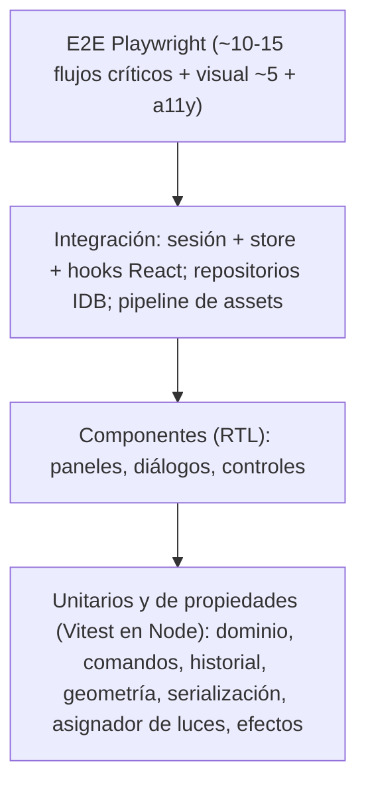

# RoomForge — Estrategia de testing

> Estado: **borrador para aprobación** · Herramientas: [ADR-0008](ADR/0008-tooling.md) · Implementación: P1-03, P1-07, P7-01…P7-03

## 1. Principios

1. **La lógica va a `core`, y `core` se prueba en Node.** El 70 % de los tests deben poder ejecutarse sin navegador, sin WebGL y en milisegundos.
2. **Los tests de propiedades protegen las invariantes** (undo/redo, límites, migraciones) mejor que los ejemplos escritos a mano.
3. **No probar píxeles salvo que sea el objetivo.** En E2E se verifica estado (sesión, `renderer.info`) y solo la regresión visual compara imágenes.
4. **Determinismo por inyección:** reloj, generador de IDs y aleatoriedad se inyectan (`clock`, `idGen`, semilla de fast-check).
5. **Un fallo debe explicar qué se rompió**: nombres descriptivos, mensajes claros.
6. **Los tests son parte de la Definition of Done**; cada issue declara los «Tests esperados».

## 2. Pirámide y reparto objetivo

| Nivel | Herramienta | Entorno | Proporción objetivo | Tiempo objetivo |
|---|---|---|---:|---|
| Unitarios + propiedades (`core`) | Vitest + fast-check | `node` | ≈ 60 % | < 10 s |
| Integración | Vitest (+ `fake-indexeddb`) | `node` / `happy-dom` | ≈ 15 % | < 30 s |
| Componentes | Vitest + RTL | `happy-dom` | ≈ 15 % | < 30 s |
| E2E / visual / a11y | Playwright | Chromium real (+ Firefox, WebKit en P7-07) | ≈ 10 % | < 6 min |

## 3. Unitarios y de propiedades (`packages/core`)

| Área | Qué se prueba | Técnica |
|---|---|---|
| Dominio | Schemas válidos/ inválidos, límites, JSON round-trip | Tabla de casos + fast-check |
| Comandos | Efecto esperado, rechazo de inválidos, invariantes I1–I7, identidad referencial | Ejemplos + secuencias aleatorias |
| Historial | `undo` total ⇒ original; `redo` ⇒ final; coalescing; gestos; límite | **Propiedades (≥1 000 secuencias)** |
| Geometría | Snap idempotente, límites de sala, wall-snap, OBB, apoyo | Tablas + propiedades |
| Serialización | Round-trip, migraciones (**golden files**), entradas hostiles | Golden + fuzz |
| Luces | `evaluateEffect` periódico y acotado; `LightAllocator` determinista y con histéresis | Tablas con reloj falso |

Reglas:
- Un **generador de documentos** (`arbitraryDocument`) comparte formas válidas para todas las propiedades (en `packages/core/src/testing`).
- Toda migración nueva exige su golden (test que enumera las migraciones y falla si falta).
- Cobertura mínima de `core`: **90 % líneas / 85 % ramas** (activa en P7-03).

## 4. Componentes y escena (`apps/web`)

- **RTL** para paneles (propiedades, catálogo, materiales, proyectos), diálogos y controles: foco, teclado, validación, estados vacíos/errores.
- La sesión se inyecta con una `EditorSession` real y catálogo de fixtures (no se mockea el dominio).
- **Funciones puras de escena** (geometría de sala/paredes, atenuación de paredes, cálculo de encuadre de cámara, tamaños de exportación) se prueban como unitarios; **no** se prueba three en jsdom.
- **Controladores de interacción** (`MoveController`…) se prueban con rayos sintéticos y una sesión real, sin WebGL.
- **Conteo de renders:** test con 500 entidades que verifica que mover 1 re-renderiza 1 vista (P2-09). Es una barrera de calidad.
- `@react-three/test-renderer` se evalúa en P2-09 para inspeccionar el grafo de escena sin GPU; si no aporta, se descarta.

## 5. E2E con Playwright y WebGL

**Objetivo:** ejercitar la app real (build estático) en un navegador real.

- **Servidor:** `pnpm e2e` construye con `NEXT_PUBLIC_E2E=1` y Playwright arranca `apps/web/scripts/serve-static.mjs` (sin dependencias) sobre `apps/web/out` en `127.0.0.1:4173`. `pnpm start:static` sirve el último build a mano.
- **WebGL en CI:** Chromium en modo headless con renderizado por software. Los *flags* candidatos (se confirman y documentan en P1-07):
  `--use-angle=swiftshader`, `--enable-unsafe-swiftshader`, `--ignore-gpu-blocklist`, y `--use-gl=angle`.
  **Resultado de P1-07 (2026-10-08):** se usan los cuatro *flags* (`WEBGL_FLAGS` en `apps/web/playwright.config.ts`). Con ellos, Chromium headless obtiene WebGL 2.0 por software: `ANGLE (Google, Vulkan 1.3.0 (SwiftShader Device (Subzero)), SwiftShader driver)`, sin GPU, en Windows local y en `ubuntu-latest`. Lo comprueba `e2e/smoke.spec.ts` (`getContext('webgl2') !== null`), y la suite pasó `--repeat-each=20` sin fallos (140/140).
  Limitaciones observadas: SwiftShader es lento (CPU), así que las escenas E2E deben ser pequeñas y usar calidad `low`. El renderizado depende de la versión de Chromium y de SwiftShader, por lo que la regresión visual (#81) debe fijar la versión de Playwright y generar las referencias en CI (Linux), nunca en local. En Windows, Next 16.4 escribe los ficheros de *prefetch* de segmentos con `\` (`__next.editor/__PAGE__.txt` en lugar de `__next.editor.__PAGE__.txt`): el servidor estático local lo compensa; en Linux (CI, hosting) no ocurre.
- **Gancho de pruebas:** con `NEXT_PUBLIC_E2E=1` se expone `window.__RF__ = { session, commands, info(), camera }` (P2-06, P2-08): la sesión viva, las fábricas de comandos (`createRoom`, `resizeRoom`) para ejecutarlos dentro de la página, `info()` con los contadores de `renderer.info` (`frame`, `calls`, `triangles`, `programs`…; `null` hasta que se monta el canvas) y `camera` con `snapshot()` (vista, posición, objetivo, zoom, distancia, `transitioning`), `fit()` y `orbit()`/`dolly()` para mover la cámara por los mismos límites que un usuario. `freezeTime()` y `setQuality()` se añadirán con los efectos animados (P5-08) y la calidad gráfica (P5-10). **Nunca** en producción (el build de producción no define la variable; un test lo comprueba).
- **Modo determinista:** `?e2e=1` congela el reloj de efectos, fija IDs y calidad `low`, desactiva animaciones de cámara.
- **Aislamiento:** cada test crea un contexto nuevo (IndexedDB limpia). Sin dependencias entre tests.
- **Selectores:** `getByRole`/`getByLabel`; `data-testid` solo para el canvas y elementos sin rol. Patrón `EditorPage` (page object).
- **Interacción con el canvas:** se calcula la posición de pantalla de un objeto desde `__RF__` (proyección de su posición mundial) y se usa el ratón de Playwright; los resultados se verifican contra la sesión, no contra píxeles.
- **Reintentos:** 1 en CI; trazas/vídeo/captura solo en fallo.

## 6. Flujos críticos E2E

| # | Flujo | Verificaciones principales |
|---:|---|---|
| 1 | Crear sala desde asistente | Sala de las dimensiones; cámara encuadrada |
| 2 | Arrastrar objeto del catálogo al suelo | Objeto creado, snap, 1 entrada de historial |
| 3 | Snap a pared y rotación | Orientación correcta; `R` 24× = vuelta completa |
| 4 | Mover, `Esc` cancela, `Ctrl+Z`/`Ctrl+Shift+Z` | Posiciones; historial |
| 5 | Monitor sobre escritorio y mover el escritorio | Hijo sigue al padre; undo en un paso |
| 6 | Cambiar material de pared/suelo | Solo la superficie elegida; `programs.length` estable |
| 7 | Luces RGB: color, intensidad, apagar todas, preset | Estado de sesión; cambio de color visible por muestreo de píxel (tolerante) |
| 8 | Día/noche | Estado; transición; sin recompilación |
| 9 | Autoguardado y recarga | Estado idéntico tras `reload`; también tras `pagehide` inmediato |
| 10 | Exportar JSON → borrar proyecto → importar | Equivalencia profunda |
| 11 | Exportar PNG | Dimensiones, alfa en modo transparente |
| 12 | Compartir enlace y abrir en contexto nuevo | Visor de solo lectura; escena equivalente |
| 13 | Pérdida de contexto WebGL | Aviso y recuperación (`WEBGL_lose_context`) |
| 14 | Error de almacenamiento (cuota simulada) | Aviso persistente y exportar copia |
| 15 | Solo teclado: crear, colocar vía outliner, deshacer, guardar | Operable sin ratón |

## 7. Regresión visual (P7-02)

- **Escenas fijas:** sala vacía; setup completo de día; setup completo de noche con RGB; vista superior; cada plantilla.
- **Solo en CI**, con la misma imagen de runner (el renderizado por software es determinista dentro de una misma configuración, pero **no** entre GPU distintas → no se ejecuta en máquinas de desarrollo como puerta).
- **Tolerancia:** umbral por píxel y porcentaje máximo de píxeles distintos, documentados; el informe adjunta *diff*.
- **Actualizar referencias:** `pnpm test:visual:update` en una rama; el PR muestra las imágenes cambiadas y exige justificación.
- Si la viabilidad del renderizado por software resulta insuficiente (spike P1-07), la regresión visual se limita a *smoke* (la escena no está en blanco) y se compensa con pruebas de estado.

## 8. Rendimiento y presupuestos (P7-03, P7-04)

| Métrica | Cómo se mide | Umbral (CI) |
|---|---|---|
| Draw calls, triángulos, programas de shader | `renderer.info` en la escena patrón (30 objetos + 8 luces) | Presupuestos de [R3F_PERFORMANCE §3](research/R3F_PERFORMANCE.md) |
| Frames en reposo | `renderer.info.render.frame` constante 5 s | 0 |
| Fugas | 200 ciclos añadir/eliminar + 50 cambios día/noche | `memory.geometries/textures` estables (±0) |
| Bundle | Análisis de chunks | JS inicial editor ≤ 450 kB gz |
| FPS reales | Manual/semiautomático en hardware de referencia (no fiable en CI por el render por software) | Informe en `docs/perf/` |

Los FPS **no** se usan como puerta de CI (el renderizado por software no es representativo); se miden en hardware real por issue de rendimiento.

## 9. Accesibilidad (P7-05)

- axe en E2E sobre editor, proyectos, visor y diálogos: 0 violaciones graves/críticas.
- Checklist manual (teclado, lector de pantalla, zoom 200 %, contraste, `prefers-reduced-motion`) archivada en la PR.

## 10. Seguridad y robustez (P7-08, P7-09)

- Fuzz de importación y de enlaces (10 000 entradas aleatorias/mutadas: sin excepciones no controladas ni cuelgues).
- Cabeceras/CSP comprobadas en E2E; consola sin violaciones.
- Pérdida de contexto WebGL, cuota, sin WebGL, versión de archivo futura, JSON corrupto.

## 11. Datos y utilidades de prueba

| Utilidad | Ubicación | Uso |
|---|---|---|
| Builders `buildRoom/buildObject/buildDocument` | `packages/core/src/testing` | Datos válidos mínimos con overrides |
| `arbitraryDocument`, `arbitraryCommandSequence` | idem | Propiedades |
| Catálogo de fixtures (5 items) | idem | Tests sin assets reales |
| `FakeClock`, `SeqIdGen` | idem | Determinismo |
| Documentos *golden* por versión | `packages/core/test/golden/` | Migraciones |
| Escena patrón de rendimiento | `apps/web/e2e/fixtures/` | Presupuestos |
| `EditorPage` | `apps/web/e2e/pages/` | E2E |

## 12. CI y política de flakiness

- `ci.yml`: job `check` (lint, tipos, deps, unit/integración/componentes con cobertura, build) y job `e2e` (Playwright sobre el build E2E; en PR y en `develop`, tras `check`; traza, vídeo e informe como artefacto solo en fallo).
- **Test inestable = bug P1.** Se pone en cuarentena (`test.fixme` con issue enlazada) en ≤ 24 h y se arregla o elimina; no se acumulan reintentos.
- Antes de fusionar una suite E2E nueva: `--repeat-each=20` sin fallos.
- Artefactos en fallo: traza de Playwright, captura, informe de cobertura.

## 13. Umbrales de cobertura

| Paquete | Líneas | Ramas | Cuándo se activa |
|---|---:|---:|---|
| `core` | 90 % | 85 % | P7-03 (antes: informativo) |
| `web` (lógica no visual) | 70 % | — | P7-03 |
| Controladores y funciones puras de escena | 85 % | — | P7-03 |

La cobertura es una **red de seguridad**, no un objetivo en sí: se revisa la calidad de las aserciones en las PR de `core`.

## 14. Cómo leer «Tests esperados» en las issues

Cada issue lista los tests mínimos. Una issue no se cierra si:
- no incluye esos tests o una justificación aceptada de por qué no aplican;
- hay tests desactivados sin issue enlazada;
- la cobertura del código nuevo de `core` queda por debajo de los umbrales.

El PR describe el **plan de pruebas ejecutado** (comandos y resultados), no solo «tests pasan».
