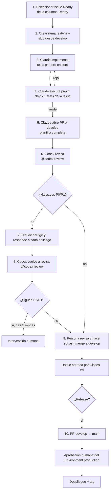

# RoomForge — Flujo de desarrollo

> Estado: **borrador para aprobación** · Decisiones: [ADR-0009](ADR/0009-git-workflow.md) · Plantillas: `.github/` · Reglas para agentes: [AGENTS.md](../AGENTS.md)

## 1. Roles

| Rol | Quién | Responsabilidad |
|---|---|---|
| **Propietario / aprobador** | Marc | Prioriza, aprueba el alcance, **fusiona en `develop` y aprueba producción**. Única persona que puede autorizar acciones remotas irreversibles. |
| **Implementador** | Claude Code | Toma una issue, crea rama, implementa, ejecuta tests, abre el PR y corrige hallazgos. |
| **Revisor** | Codex (`@codex review`) | Revisa el PR según `AGENTS.md → Review guidelines`. No fusiona. |
| **Ejecutor de CI/CD** | GitHub Actions | Comprueba y despliega. Producción solo tras aprobación humana. |

## 2. Ciclo de una issue



Reglas del ciclo:
- **Una issue = una rama = un PR.** Si la issue crece, se divide (nueva issue), no se amplía el PR.
- **Nadie fusiona automáticamente.** Ni agentes ni *auto-merge*. (Ver §7.)
- Antes de empezar: Definition of Ready ([ROADMAP §8](ROADMAP.md#8-definition-of-ready--done)).

## 3. Ramas

| Rama | Propósito | Reglas |
|---|---|---|
| `main` | Producción | Solo recibe PR desde `develop` (y `hotfix/*`). Protegida. |
| `develop` | Integración (rama por defecto) | Solo recibe PR de ramas de trabajo. Protegida. |
| `feat/<n>-<slug>` | Funcionalidad | Desde `develop`. |
| `fix/<n>-<slug>` | Corrección de bug | Desde `develop` (o `main` si hotfix). |
| `refactor/…`, `perf/…`, `test/…`, `docs/…`, `chore/…`, `ci/…`, `build/…` | Otros tipos | Desde `develop`. |
| `hotfix/<slug>` | Urgente en producción | Desde `main`; PR a `main` **y** *back-merge* a `develop`. |
| `spike/<n>-<slug>` | Experimento desechable | No se fusiona; el resultado va a un informe/ADR. |

`<n>` es el **número de la issue de GitHub**; `<slug>`, ≤ 5 palabras en inglés, minúsculas y guiones. Ejemplo: `feat/42-move-controller`.

## 4. Commits (Conventional Commits)

Formato: `tipo(ámbito): descripción en imperativo, minúsculas, sin punto, ≤ 72 caracteres`.

- **Tipos:** `feat`, `fix`, `refactor`, `perf`, `test`, `docs`, `chore`, `ci`, `build`, `revert`.
- **Ámbitos:** `core`, `scene`, `ui`, `editor`, `catalog`, `persistence`, `export`, `ai`, `infra`, `deps`, `adr`, `planning`.
- **Cuerpo** (opcional): el *porqué*, no el *qué*. **Pie:** `Refs #n` (commits) — `Closes #n` va en la descripción del PR.
- Cambio incompatible: `feat(core)!: …` + `BREAKING CHANGE:` en el pie.
- Idioma: **inglés** en commits, PRs, ramas y código; **español** en documentación e issues.
- Los agentes añaden el trailer `Co-Authored-By` indicado por su configuración.

Ejemplos:
```text
feat(core): add undo/redo history with gesture coalescing
fix(scene): keep dragged object inside room bounds when rotating
perf(scene): reuse scratch vectors in move controller
docs(adr): accept ADR-0003 after spike results
```

## 5. Pull requests

- **Título** = Conventional Commit (será el mensaje del *squash*).
- **Destino:** `develop` (salvo release/hotfix).
- **Tamaño:** ≤ 400 líneas netas (sin lockfile ni generados). Mayor ⇒ dividir la issue.
- **Borrador** hasta que `pnpm check` y los tests de la issue pasen.
- **Descripción** (plantilla `.github/PULL_REQUEST_TEMPLATE.md`): resumen, issue (`Closes #n`), cambios, **plan de pruebas ejecutado con resultados**, capturas/GIF si hay UI, impacto en rendimiento (`renderer.info` antes/después si toca el render), riesgos y checklist de Definition of Done.
- **Etiquetas:** las de la issue + `needs-review` al abrir.
- Un PR **no** modifica configuración de ramas, secretos ni workflows de despliegue salvo que la issue lo pida explícitamente.

## 6. Revisión con Codex

1. Al abrir el PR (o con la revisión automática activada, P1-09), comentar `@codex review`.
2. Codex aplica `AGENTS.md → ## Review guidelines` (el archivo más cercano a cada cambio prevalece). Por defecto señala hallazgos **P0/P1**.
3. Claude responde **a cada hallazgo** en el hilo: `Fixed in <sha>` / `Won't fix: <razón>` / `Follow-up: #n`.
4. Tras empujar correcciones: comentar de nuevo `@codex review` (las reseñas automáticas se disparan al abrir el PR, **no** en cada push).
5. **Máximo 2 rondas automáticas.** Si quedan P0/P1 abiertos o hay desacuerdo → intervención humana.
6. Hallazgos P2/P3 no bloquean: se resuelven o se convierten en issues (`type:task`, `P2`/`P3`).
7. La revisión de Codex **no sustituye** la lectura humana antes de fusionar.

Nota: `@codex fix it` existe pero **no se usa**; en este flujo corrige Claude (un solo implementador, historial coherente).

## 7. Fusión

| Destino | Quién | Cómo | Condiciones |
|---|---|---|---|
| `develop` | **Persona** (Marc) | *Squash and merge* | `check` y `e2e` verdes, conversaciones resueltas, sin P0/P1 abiertos de Codex |
| `main` | **Persona** | *Merge commit* (PR `develop → main`) | Checklist de release; después, **aprobación del Environment `production`** |

Prohibido para agentes: fusionar, activar *auto-merge*, aprobar entornos, cambiar protecciones, `git push --force`, borrar ramas protegidas, tocar secretos.

## 8. Hotfix

1. Rama `hotfix/<slug>` desde `main`; arreglo mínimo + test de regresión.
2. PR a `main` (checks + aprobación de producción); tag de parche.
3. PR de *back-merge* `main → develop` el mismo día.

## 9. Labels, tablero y estados

- **Labels:** `type:*`, `P0-critical … P3-future`, `area:*`, `size:*`, `blocked`, `needs-decision`, `human-required`, `post-mvp`, `regression`, `severity:*` (ver `tools/planning/labels.json`).
- **Tablero** (GitHub Projects): `Backlog → Ready → In progress → In review → Done`. «Ready» exige Definition of Ready.
- **Hitos:** M0…M9 (uno por fase); cada hito termina con demo y etiqueta Git `m<N>`.
- **Épicas:** issue con lista de tareas hijas (generada por el importador).

## 10. Gestión de bugs

**Reporte:** plantilla `bug_report.yml` (versión, navegador, GPU/calidad, pasos, esperado/obtenido, captura, `__RF__` opcional). Nunca adjuntar datos personales; el proyecto es opcional y explícito.

| Severidad | Definición | Prioridad | Objetivo de respuesta interna |
|---|---|---|---|
| `severity:critical` | Pérdida de datos, crash al abrir, no se puede guardar, brecha de seguridad | **P0** | Triage < 24 h; arreglo prioritario / hotfix |
| `severity:major` | Función principal degradada (no se puede mover/exportar/iluminar), regresión de rendimiento grave | **P1** | Triage < 3 días; en el siguiente hito |
| `severity:minor` | Molestia con alternativa, cosmético | **P2** | Triage semanal |

Proceso:
1. **Triage semanal** (15 min): reproducir, etiquetar (`severity:*`, `area:*`, `regression`?), asignar prioridad e hito.
2. **Regresión** (`regression`): primero test que falla, luego arreglo; añadir al E2E si es un flujo crítico.
3. Un bug se cierra con **test de regresión** (o justificación documentada).
4. Bugs de la beta: se enlazan al informe de feedback; los duplicados se cierran con referencia.

## 11. Convenciones de código (resumen; reglas completas en AGENTS.md)

- TypeScript estricto; sin `any`; exports nombrados; módulos pequeños; funciones puras en `core`.
- `core` no importa React/three/DOM; los módulos web respetan la matriz de dependencias ([ARCHITECTURE §2.1](ARCHITECTURE.md)).
- Nada de `setState`/asignaciones en el camino caliente del render.
- Todo cambio del documento va por un **Comando**.
- Dependencias nuevas: justificadas en el PR (tamaño, mantenimiento, licencia, alternativa sin dependencia).
- Sin comentarios que expliquen *qué* hace el código; sí el *porqué* no evidente.
- Textos de UI en diccionarios (es/en); nunca literales sueltos.

## 12. Cómo empieza una sesión con un agente

1. Leer `AGENTS.md` y la issue completa (con enlaces a docs).
2. Confirmar Definition of Ready y dependencias cerradas.
3. Crear rama, escribir tests primero cuando sea lógica de `core`, implementar en pasos pequeños con commits convencionales.
4. Ejecutar `pnpm check` y los tests de la issue; pegar resultados en el PR.
5. Abrir PR en borrador → marcar listo → solicitar revisión.
